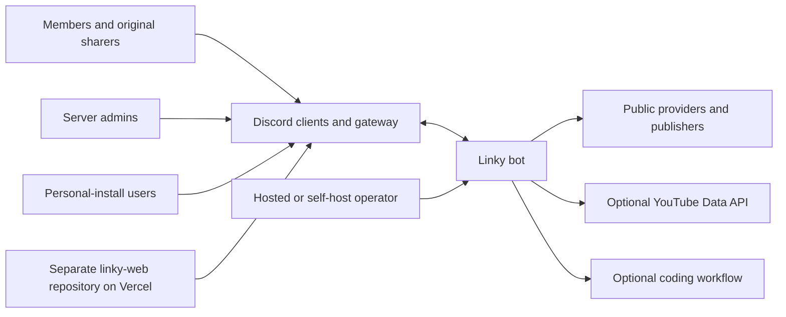
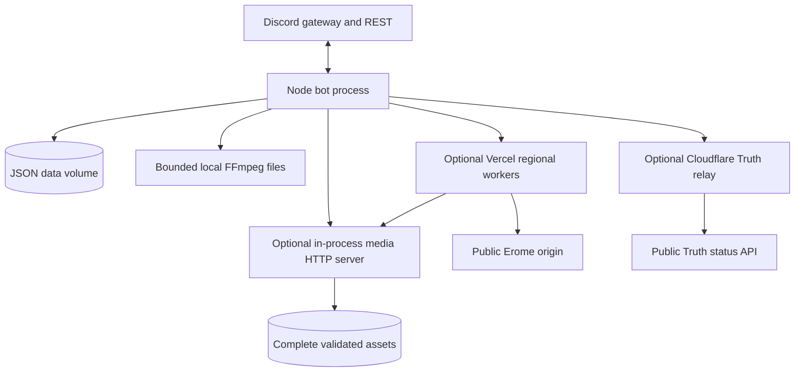
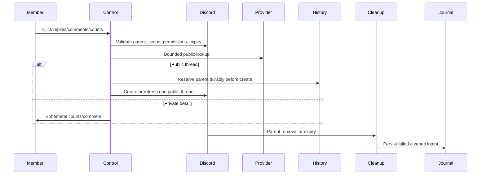
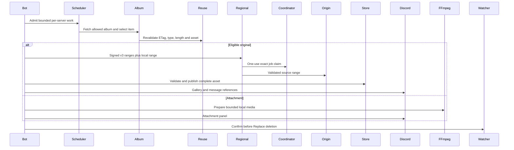
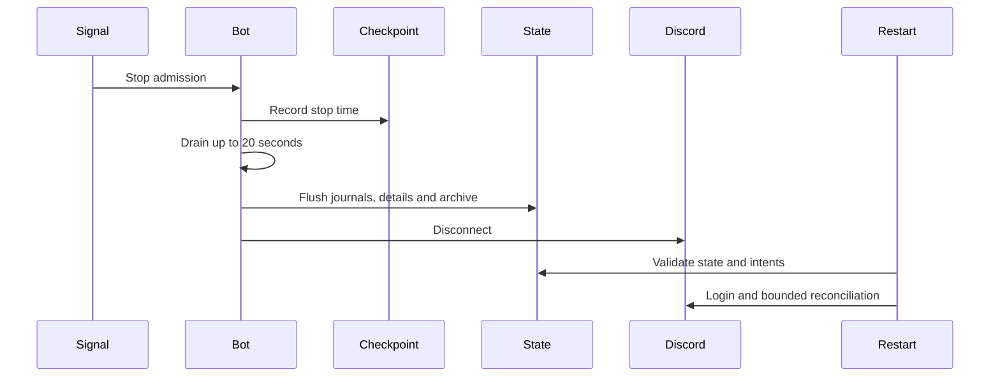

# Architecture — Linky

Related: [SRS](SRS.md) · [Data Contracts](DATA_CONTRACTS.md)

Descriptive ADOPT baseline: code at `1a69229`, inspected 2026-11-26. Area requirements and all product-wide CON/NFR definitions are assigned by [SRS §3](SRS.md#3-requirements); this foundation allocates no requirement ids and does not certify current production health.

## 1. Goals and quality drivers
| Driver | Source | Architectural response |
|---|---|---|
| Preserve originals on uncertainty | README; delivery-reliability | Matching preview confirmation and fresh source/settings/ownership checks |
| Bound public retrieval | VERIFICATION stage 1; historical runtime-security audit | Fixed provider paths; public-DNS pinning for articles; finite request and resource limits |
| Private operational evidence | operator-reliability; delivery-reliability | Short-lived message-bound Details separate from identity-free archive |
| Optional self-host media | erome-previews; erome-regional-hosting | Signed regional ranges, validated complete assets and attachment fallback |
| Predictable operations | Compose; CI/Deploy workflows | One owning process and data volume; tested revision deployment and rollback |

## 2. Constraints
Node/TypeScript Discord application, JSON persistence and a single owning process. Hosted Erome is excluded; self-host operators supply media infrastructure. Product-wide normative constraints belong only to core. Public fetches do not forward member credentials or cookies. Discord, YouTube, GitHub and optional relay/coordinator authentication are intended operator boundaries. General public article retrieval validates public destinations rather than using a fixed publisher catalog; it is not an exposed arbitrary proxy. Blanket fixed-host/no-credentials/no-arbitrary-URL wording needs scope clarification (SRS TBD-S0-001). No login/paywall bypass is implemented. The optional Truth relay changes network location for the same signed-out public status path; anti-bot wording needs the same clarification.

## 3. System context (C4 level 1)

Discord owns presentation and permission state. Linky rewrites or authors previews and checks delivery evidence. Provider availability and client playback are external dependencies; the website is a separate product repository.

## 4. Containers and components (C4 level 2)

Logical source modules below are not separate processes. The nine `api/` wrappers instantiate RegionalWorker at configured Vercel locations. Pure type/helper modules are included because later requirements can cite their validation boundaries. Source links own exports; local import edges are listed directly.

| Id | Component | Responsibility | Technology | Owns data | Exposes | Depends on |
|---|---|---|---|---|---|---|
| CMP-001 | [index](../src/index.ts) | Start, log in and drain bot on signals | §4.1 bot | none (stateless or memory-only) | Module exports / workflow entry | CMP-002, CMP-003, CMP-004 |
| CMP-002 | [bot](../src/bot.ts) | Wire gateway, interactions, catch-up and service lifecycle | §4.1 bot | none (stateless or memory-only) | API-029, API-034, API-035 | CMP-058, CMP-054, CMP-077, CMP-003, CMP-004, CMP-089, CMP-093, CMP-092, CMP-086, CMP-087, CMP-090, CMP-094, CMP-091, CMP-065, CMP-045, CMP-085, CMP-043, CMP-068, CMP-074, CMP-032, CMP-010, CMP-011, CMP-078, CMP-083, CMP-080, CMP-006, CMP-084, CMP-063, CMP-013, CMP-046, CMP-082, CMP-064, CMP-048, CMP-020, CMP-029, CMP-030, CMP-018, CMP-014, CMP-017, CMP-047, CMP-067, CMP-049, CMP-023, CMP-022, CMP-024, CMP-025, CMP-028, CMP-015, CMP-031, CMP-066 |
| CMP-003 | [config](../src/config.ts) | Validate operator configuration and optional feature admission | §4.1 bot | none (stateless or memory-only) | Module exports / workflow entry | CMP-035, CMP-029, CMP-024, CMP-006, CMP-071 |
| CMP-004 | [logger](../src/logger.ts) | Serialize safe structured operational logs | §4.1 bot | none (stateless or memory-only) | Module exports / workflow entry | Runtime / external services |
| CMP-005 | [ArticlePosts](../src/services/ArticlePosts.ts) | Compose article cards, upload bundles and attachment-free fallback | §4.1 bot | none (stateless or memory-only) | Module exports / workflow entry | CMP-006, CMP-035, CMP-036, CMP-058, CMP-071, CMP-075 |
| CMP-006 | [ArticlePreview](../src/services/ArticlePreview.ts) | Fetch pinned public metadata, PDF prefixes and Truth Social/LinkedIn media | §4.1 bot | none (stateless or memory-only) | API-043, API-044, API-045, API-046, API-047, API-048, API-055 | CMP-037, CMP-038, CMP-058, CMP-036, CMP-051, CMP-044, CMP-069, CMP-071 |
| CMP-007 | [AtomicWrite](../src/services/AtomicWrite.ts) | Private exclusive temporary write, sync, rename and directory sync | §4.1 bot | none (stateless or memory-only) | Module exports / workflow entry | Runtime / external services |
| CMP-008 | [AttachmentLimits](../src/services/AttachmentLimits.ts) | Preserve Discord's explicit allowance, reserve a margin, and cap local video processing. | §4.1 bot | none (stateless or memory-only) | Module exports / workflow entry | Runtime / external services |
| CMP-009 | [BlueskyPanel](../src/services/BlueskyPanel.ts) | A lone Bluesky post that can be shown as one block, with its images and fixer link. | §4.1 bot | none (stateless or memory-only) | Module exports / workflow entry | CMP-010, CMP-035, CMP-036, CMP-069, CMP-072 |
| CMP-010 | [BlueskyPost](../src/services/BlueskyPost.ts) | Retrieve and validate public Bluesky posts, quoted text and image metadata | §4.1 bot | none (stateless or memory-only) | API-039 | CMP-034, CMP-012, CMP-069, CMP-074 |
| CMP-011 | [BlueskyReplies](../src/services/BlueskyReplies.ts) | Validate anchor identity independently of embeds; keep only public direct replies. | §4.1 bot | none (stateless or memory-only) | API-040 | CMP-034, CMP-012, CMP-010, CMP-069, CMP-058 |
| CMP-012 | [BoundedJson](../src/services/BoundedJson.ts) | Decode bounded UTF-8 JSON with cancellation | §4.1 bot | none (stateless or memory-only) | Module exports / workflow entry | Runtime / external services |
| CMP-013 | [CleanupFailure](../src/services/CleanupFailure.ts) | Copy only numeric error metadata; never forward SDK errors, message text or identity fields. | §4.1 bot | none (stateless or memory-only) | Module exports / workflow entry | Runtime / external services |
| CMP-014 | [DeliveryArchive](../src/services/DeliveryArchive.ts) | Archive identity-free finalized measurements and coverage health | §4.1 bot | ENT-010, ENT-011 | API-026 | CMP-007, CMP-016, CMP-018 |
| CMP-015 | [DeliveryAttempt](../src/services/DeliveryAttempt.ts) | Shared deadline and private diagnostic binding for automatic and explicit deliveries. | §4.1 bot | none (stateless or memory-only) | Module exports / workflow entry | CMP-016, CMP-018, CMP-017, CMP-036, CMP-069, CMP-078, CMP-080, CMP-021, CMP-006 |
| CMP-016 | [DeliveryContext](../src/services/DeliveryContext.ts) | Define finite delivery platform, stage, path and outcome categories | §4.1 bot | none (stateless or memory-only) | Module exports / workflow entry | CMP-035 |
| CMP-017 | [DeliveryDetails](../src/services/DeliveryDetails.ts) | Shared server previews expose read-only details; every response is private to its clicker. | §4.1 bot | none (stateless or memory-only) | API-013 | CMP-018, CMP-016 |
| CMP-018 | [DeliveryDiagnostics](../src/services/DeliveryDiagnostics.ts) | Bind private outcome/timing details to Discord messages | §4.1 bot | ENT-009 | API-027 | CMP-007, CMP-016 |
| CMP-019 | [DeliveryProgress](../src/services/DeliveryProgress.ts) | Coalesce noisy work events. stop() drains the one in-flight edit before a final response. | §4.1 bot | none (stateless or memory-only) | Module exports / workflow entry | CMP-016 |
| CMP-020 | [Erome](../src/services/Erome.ts) | Compatibility seam for existing callers; runtime preparation uses the injected shared scheduler. | §4.1 bot | none (stateless or memory-only) | API-051 | CMP-076, CMP-025, CMP-021, CMP-026, CMP-030, CMP-027, CMP-028, CMP-016 |
| CMP-021 | [EromeAlbum](../src/services/EromeAlbum.ts) | Canonical public album URLs only. Query/fragment tracking never selects another album. | §4.1 bot | none (stateless or memory-only) | API-050 | Runtime / external services |
| CMP-022 | [EromeAlbumPolicy](../src/services/EromeAlbumPolicy.ts) | Recheck public album actions against current channel, member, source and server policy. | §4.1 bot | none (stateless or memory-only) | Module exports / workflow entry | CMP-003, CMP-023, CMP-025, CMP-064, CMP-065, CMP-068, CMP-024 |
| CMP-023 | [EromeAlbumSessions](../src/services/EromeAlbumSessions.ts) | Location-bound sessions contain only the current album, never a user-supplied action URL. Sessions expire on restart; published media ownership r | §4.1 bot | none (stateless or memory-only) | API-014 | CMP-016, CMP-019, CMP-021, CMP-035, CMP-028 |
| CMP-024 | [EromeAvailability](../src/services/EromeAvailability.ts) | Unset preserves self-hosted availability; an explicit restriction must parse without ambiguity. | §4.1 bot | none (stateless or memory-only) | Module exports / workflow entry | CMP-003, CMP-035 |
| CMP-025 | [EromeDelivery](../src/services/EromeDelivery.ts) | Callers require a server; threads use their parent and unknown channels are not eligible. | §4.1 bot | none (stateless or memory-only) | Module exports / workflow entry | CMP-020, CMP-036, CMP-065, CMP-016, CMP-021, CMP-028, CMP-075 |
| CMP-026 | [EromeImage](../src/services/EromeImage.ts) | Separate image transport; regional MP4 jobs retain their existing strict protocol and allowlist. | §4.1 bot | none (stateless or memory-only) | API-052 | CMP-021, CMP-051, CMP-052 |
| CMP-027 | [EromeJobs](../src/services/EromeJobs.ts) | Coalesced work has its own lifetime; one departing consumer cannot cancel another's preparation. | §4.1 bot | none (stateless or memory-only) | Module exports / workflow entry | CMP-016 |
| CMP-028 | [EromeMedia](../src/services/EromeMedia.ts) | A timed-out POST can still have succeeded. Read once after a grace period; never submit it again here. | §4.1 bot | none (stateless or memory-only) | Module exports / workflow entry | CMP-042, CMP-036, CMP-020, CMP-039, CMP-076, CMP-016, CMP-021 |
| CMP-029 | [EromeMediaRuntime](../src/services/EromeMediaRuntime.ts) | Own EromeMediaSettings, mediaBaseUrl, createEromeMediaPreparer, EromeMediaRuntime | §4.1 bot | none (stateless or memory-only) | Module exports / workflow entry | CMP-039, CMP-041, CMP-050, CMP-076, CMP-020, CMP-028, CMP-040, CMP-027, CMP-026, CMP-021, CMP-030 |
| CMP-030 | [EromeWorkScheduler](../src/services/EromeWorkScheduler.ts) | Rotate bounded preparation across servers and resource profiles | §4.1 bot | none (stateless or memory-only) | Module exports / workflow entry | CMP-016 |
| CMP-031 | [InFlightWork](../src/services/InFlightWork.ts) | Running message and interaction handlers that shutdown lets finish before cancelling them. | §4.1 bot | none (stateless or memory-only) | Module exports / workflow entry | Runtime / external services |
| CMP-032 | [InstagramPost](../src/services/InstagramPost.ts) | One item of the post on the provider's signed offload route, with the dimensions it reported. | §4.1 bot | none (stateless or memory-only) | API-038 | CMP-069 |
| CMP-033 | [InstagramPresentation](../src/services/InstagramPresentation.ts) | A lone post whose every item has a provider address, shown as one block: its author and media, never its caption. | §4.1 bot | none (stateless or memory-only) | Module exports / workflow entry | CMP-032, CMP-036, CMP-069, CMP-072 |
| CMP-034 | [JsonFields](../src/services/JsonFields.ts) | Small fail-closed guards for anonymous provider payloads. | §4.1 bot | none (stateless or memory-only) | Module exports / workflow entry | Runtime / external services |
| CMP-035 | [LinkConfiguration](../src/services/LinkConfiguration.ts) | Discord snowflake: 17-20 digits without a leading zero. | §4.1 bot | none (stateless or memory-only) | Module exports / workflow entry | Runtime / external services |
| CMP-036 | [LinkTokens](../src/services/LinkTokens.ts) | Keep sentence punctuation and paired Markdown outside a URL's query string. | §4.1 bot | none (stateless or memory-only) | Module exports / workflow entry | Runtime / external services |
| CMP-037 | [LinkedIn](../src/services/LinkedIn.ts) | A public LinkedIn post read from the signed-out page's Schema.org JSON-LD. The page's own Open Graph image is a generic LinkedIn logo, so the car | §4.1 bot | none (stateless or memory-only) | Module exports / workflow entry | CMP-071 |
| CMP-038 | [LinkedInComments](../src/services/LinkedInComments.ts) | Isolated from the card parser: keep only bounded usable comments, in page order. | §4.1 bot | none (stateless or memory-only) | Module exports / workflow entry | CMP-057, CMP-037, CMP-058 |
| CMP-039 | [MediaAssetStore](../src/services/MediaAssetStore.ts) | Own complete validated assets and message references | §4.1 bot | ENT-012 | Module exports / workflow entry | CMP-035 |
| CMP-040 | [MediaReuseIndex](../src/services/MediaReuseIndex.ts) | Persist salted descriptors for revalidated reuse | §4.1 bot | ENT-013 | Module exports / workflow entry | CMP-007, CMP-039 |
| CMP-041 | [MediaServer](../src/services/MediaServer.ts) | Serve registered files and signed coordinator claims | §4.1 bot | none (stateless or memory-only) | API-021, API-022, API-023 | CMP-039, CMP-052 |
| CMP-042 | [MediaWatch](../src/services/MediaWatch.ts) | The raw message fields a media check reads, from a Gateway packet or a fetched message. | §4.1 bot | none (stateless or memory-only) | Module exports / workflow entry | Runtime / external services |
| CMP-043 | [MobileShareLinks](../src/services/MobileShareLinks.ts) | Canonical source URL to the first original share token that fits a link button. | §4.1 bot | none (stateless or memory-only) | API-049 | CMP-036, CMP-051, CMP-069 |
| CMP-044 | [PdfPreview](../src/services/PdfPreview.ts) | Parse bounded PDF metadata and first-page text | §4.1 bot | none (stateless or memory-only) | Module exports / workflow entry | Runtime / external services |
| CMP-045 | [PersonalPreferences](../src/services/PersonalPreferences.ts) | Persist member automatic-fix opt-outs | §4.1 bot | ENT-002 | Module exports / workflow entry | CMP-007, CMP-035 |
| CMP-046 | [PreviewRecovery](../src/services/PreviewRecovery.ts) | Inspect useful previews and attempt bounded fallback | §4.1 bot | none (stateless or memory-only) | Module exports / workflow entry | CMP-036, CMP-069, CMP-078, CMP-080, CMP-006, CMP-005 |
| CMP-047 | [PreviewWatcher](../src/services/PreviewWatcher.ts) | Subscribe before publication; confirm matching gateway updates | §4.1 bot | none (stateless or memory-only) | Module exports / workflow entry | CMP-046 |
| CMP-048 | [PromptService](../src/services/PromptService.ts) | Persist admission/status and dispatch fixed GitHub workflow | §4.1 bot | ENT-014 | API-032, API-033, API-056 | CMP-012 |
| CMP-049 | [ProviderHealth](../src/services/ProviderHealth.ts) | Route only on repeated, paired evidence: this provider missed a post an alternate actually previewed. | §4.1 bot | none (stateless or memory-only) | Module exports / workflow entry | CMP-036, CMP-069, CMP-046 |
| CMP-050 | [RegionalDownloader](../src/services/RegionalDownloader.ts) | Inspect source and assemble exact local/regional ranges | §4.1 bot | none (stateless or memory-only) | API-053, API-054 | CMP-051, CMP-052 |
| CMP-051 | [RegionalHttp](../src/services/RegionalHttp.ts) | Pin public DNS and validate bounded source HTTP | §4.1 bot | none (stateless or memory-only) | Module exports / workflow entry | CMP-052 |
| CMP-052 | [RegionalProtocol](../src/services/RegionalProtocol.ts) | Canonical v3 jobs, signatures and range partitioning | §4.1 bot | none (stateless or memory-only) | Module exports / workflow entry | Runtime / external services |
| CMP-053 | [RegionalWorker](../src/services/RegionalWorker.ts) | Validate and claim signed jobs; stream exact source range | §4.1 regional | none (stateless or memory-only) | API-024 | CMP-052, CMP-051 |
| CMP-054 | [ReplyCleanupJournal](../src/services/ReplyCleanupJournal.ts) | Retry related thread cleanup independently | §4.1 bot | ENT-007 | Module exports / workflow entry | CMP-007, CMP-035, CMP-058 |
| CMP-055 | [ReplyContext](../src/services/ReplyContext.ts) | Keep quoted content on one line, without revealing spoilers or unfurling links. | §4.1 bot | none (stateless or memory-only) | Module exports / workflow entry | CMP-035, CMP-036, CMP-063 |
| CMP-056 | [ReplyCreationHistory](../src/services/ReplyCreationHistory.ts) | Reserve parent identities before thread creation | §4.1 bot | ENT-006 | Module exports / workflow entry | CMP-007, CMP-035 |
| CMP-057 | [ReplyText](../src/services/ReplyText.ts) | Make provider prose inert. Default truncation preserves YouTube source-length semantics; reply pages opt into a serialized character budget. | §4.1 bot | none (stateless or memory-only) | Module exports / workflow entry | Runtime / external services |
| CMP-058 | [ReplyThreads](../src/services/ReplyThreads.ts) | Authorize and serialize public reply/comment thread creation and refresh | §4.1 bot | none (stateless or memory-only) | API-016, API-017, API-018, API-019 | CMP-056, CMP-038, CMP-010, CMP-057, CMP-069, CMP-074 |
| CMP-059 | [RepostAttachments](../src/services/RepostAttachments.ts) | Discord.js URL uploads do not check HTTP status, so download and verify first. | §4.1 bot | none (stateless or memory-only) | API-057 | Runtime / external services |
| CMP-060 | [RepostDelivery](../src/services/RepostDelivery.ts) | Publish and reconcile repost delivery | §4.1 bot | none (stateless or memory-only) | Module exports / workflow entry | CMP-005, CMP-020, CMP-032, CMP-036, CMP-046, CMP-006, CMP-069, CMP-078, CMP-080 |
| CMP-061 | [RepostEligibility](../src/services/RepostEligibility.ts) | Own bypassLinky, canCopy, sourceVersion | §4.1 bot | none (stateless or memory-only) | Module exports / workflow entry | CMP-059 |
| CMP-062 | [RepostPresentation](../src/services/RepostPresentation.ts) | Quote plain leading context without pulling apart existing Markdown or URLs. | §4.1 bot | none (stateless or memory-only) | Module exports / workflow entry | CMP-036, CMP-069, CMP-078, CMP-080, CMP-020, CMP-006, CMP-055 |
| CMP-063 | [RepostRegistry](../src/services/RepostRegistry.ts) | Persist ownership and removal/refresh intents | §4.1 bot | ENT-004, ENT-005 | API-011 | CMP-007, CMP-013, CMP-035 |
| CMP-064 | [ServerScope](../src/services/ServerScope.ts) | Supply only for a thread; categories do not implicitly match a channel preference. | §4.1 bot | none (stateless or memory-only) | Module exports / workflow entry | CMP-065 |
| CMP-065 | [ServerSettings](../src/services/ServerSettings.ts) | Persist enablement, server scope and preferences | §4.1 bot | ENT-001 | Module exports / workflow entry | CMP-007, CMP-035 |
| CMP-066 | [ServiceCheckpoint](../src/services/ServiceCheckpoint.ts) | Persist restart timing and recent catch-up channels | §4.1 bot | ENT-003 | Module exports / workflow entry | CMP-007, CMP-035 |
| CMP-067 | [SetupPreviewTest](../src/services/SetupPreviewTest.ts) | Called only by the explicit setup button. Follow-up metadata preserves requester-only Remove. | §4.1 bot | none (stateless or memory-only) | Module exports / workflow entry | CMP-003, CMP-094, CMP-092, CMP-065, CMP-047, CMP-046, CMP-069 |
| CMP-068 | [SocialLinkService](../src/services/SocialLinkService.ts) | Coordinate automatic eligibility, composition, confirmation and source deletion | §4.1 bot | none (stateless or memory-only) | Module exports / workflow entry | CMP-038, CMP-010, CMP-058, CMP-036, CMP-074, CMP-032, CMP-009, CMP-033, CMP-065, CMP-084, CMP-078, CMP-080, CMP-069, CMP-059, CMP-064, CMP-063, CMP-046, CMP-073, CMP-072, CMP-042, CMP-055, CMP-020, CMP-025, CMP-008, CMP-075, CMP-028, CMP-019, CMP-015, CMP-018, CMP-047, CMP-049, CMP-023, CMP-035, CMP-062, CMP-070, CMP-043, CMP-006, CMP-005, CMP-061, CMP-060 |
| CMP-069 | [SocialProviders](../src/services/SocialProviders.ts) | Stable post identity for non-X platforms; Bluesky includes the actor and record key. | §4.1 bot | none (stateless or memory-only) | API-028, API-059 | CMP-036, CMP-035 |
| CMP-070 | [SourceMentions](../src/services/SourceMentions.ts) | Only the sender's explicit, Discord-resolved user tags can become notification recipients. | §4.1 bot | none (stateless or memory-only) | Module exports / workflow entry | CMP-036 |
| CMP-071 | [TruthSocial](../src/services/TruthSocial.ts) | Where the post data came from; the status API is preferred, the others serve hosts its bot protection blocks. | §4.1 bot | none (stateless or memory-only) | Module exports / workflow entry | Runtime / external services |
| CMP-072 | [TweetPanel](../src/services/TweetPanel.ts) | A gallery plays a video or GIF only from a file Discord can fetch; an HLS playlist is not one. | §4.1 bot | none (stateless or memory-only) | API-058 | CMP-042, CMP-036, CMP-074 |
| CMP-073 | [TweetPresentation](../src/services/TweetPresentation.ts) | Split at readable boundaries without cutting a generated Markdown link or escape. | §4.1 bot | none (stateless or memory-only) | Module exports / workflow entry | CMP-074, CMP-072, CMP-035, CMP-036, CMP-069 |
| CMP-074 | [TweetTranslation](../src/services/TweetTranslation.ts) | One validated photo, video or GIF address with the dimensions the provider reported. | §4.1 bot | none (stateless or memory-only) | API-036 | CMP-069, CMP-012 |
| CMP-075 | [UploadedMedia](../src/services/UploadedMedia.ts) | A standalone prepared media file and its accompanying text, in one panel. | §4.1 bot | none (stateless or memory-only) | Module exports / workflow entry | Runtime / external services |
| CMP-076 | [VideoAttachment](../src/services/VideoAttachment.ts) | Invalid allowances fail closed; a server's larger allowance never removes our own resource bound. | §4.1 bot | none (stateless or memory-only) | Module exports / workflow entry | CMP-030 |
| CMP-077 | [XReplies](../src/services/XReplies.ts) | Validate the one public conversation page; count each discarded entry once. | §4.1 bot | none (stateless or memory-only) | API-037 | CMP-034, CMP-012, CMP-058, CMP-069 |
| CMP-078 | [YouTube](../src/services/YouTube.ts) | Keep native YouTube playback, accepting only exact video URL shapes. | §4.1 bot | none (stateless or memory-only) | API-041 | CMP-079, CMP-057, CMP-012, CMP-036 |
| CMP-079 | [YouTubeComments](../src/services/YouTubeComments.ts) | Keep only top-level comments for the requested video, preserving relevance order. | §4.1 bot | none (stateless or memory-only) | Module exports / workflow entry | CMP-058 |
| CMP-080 | [YouTubeCommunity](../src/services/YouTubeCommunity.ts) | Only post permalinks; channel pages, video links and nested URLs are not posts. | §4.1 bot | none (stateless or memory-only) | API-042 | CMP-036, CMP-069, CMP-078, CMP-021, CMP-043, CMP-051 |
| CMP-081 | [YouTubeControls](../src/services/YouTubeControls.ts) | Keep the native embed untouched; only small, readable controls carry the counts. | §4.1 bot | none (stateless or memory-only) | Module exports / workflow entry | CMP-078 |
| CMP-082 | [YouTubeInteractions](../src/services/YouTubeInteractions.ts) | YouTube controls disclose details only in a private reply to the person who clicked. | §4.1 bot | none (stateless or memory-only) | API-015 | CMP-078, CMP-081, CMP-084 |
| CMP-083 | [YouTubeReplyTarget](../src/services/YouTubeReplyTarget.ts) | Read the exact publish count from the bot's control; keep the ticket's stable custom ID. | §4.1 bot | none (stateless or memory-only) | Module exports / workflow entry | CMP-064, CMP-058, CMP-078 |
| CMP-084 | [YouTubeStats](../src/services/YouTubeStats.ts) | Persist expiring statistics/control cleanup | §4.1 bot | ENT-008 | Module exports / workflow entry | CMP-007, CMP-013, CMP-035, CMP-081 |
| CMP-085 | [autofix](../src/commands/autofix.ts) | Own data, execute | §4.1 bot | none (stateless or memory-only) | API-004 | CMP-045 |
| CMP-086 | [diagnose](../src/commands/diagnose.ts) | Returns known observations; diagnostics do not require an external network probe. | §4.1 bot | none (stateless or memory-only) | API-005 | CMP-003, CMP-065, CMP-064, CMP-035, CMP-069, CMP-078, CMP-080, CMP-006, CMP-071, CMP-037, CMP-043, CMP-092, CMP-020, CMP-025, CMP-024 |
| CMP-087 | [fix](../src/commands/fix.ts) | Only URL tokens supplied by this explicit interaction are used; nothing is fetched from chat history. | §4.1 bot | none (stateless or memory-only) | API-006, API-007, API-012 | CMP-038, CMP-010, CMP-058, CMP-003, CMP-036, CMP-069, CMP-078, CMP-006, CMP-005, CMP-080, CMP-062, CMP-046, CMP-020, CMP-025, CMP-065, CMP-008, CMP-028, CMP-019, CMP-015, CMP-018, CMP-047, CMP-049, CMP-023, CMP-024, CMP-043, CMP-033, CMP-032, CMP-009, CMP-073, CMP-072, CMP-042, CMP-074, CMP-060, CMP-075, CMP-088 |
| CMP-088 | [fixMedia](../src/commands/fixMedia.ts) | The caller can publish a card in place of a block whose media is not confirmed. | §4.1 bot | none (stateless or memory-only) | Module exports / workflow entry | CMP-015, CMP-019, CMP-023, CMP-028, CMP-046 |
| CMP-089 | [help](../src/commands/help.ts) | Own data, execute | §4.1 bot | none (stateless or memory-only) | API-001 | CMP-003, CMP-065, CMP-092, CMP-064, CMP-024 |
| CMP-090 | [prompt](../src/commands/prompt.ts) | Own data, execute, handleStatus | §4.1 bot | none (stateless or memory-only) | API-008, API-020 | CMP-048 |
| CMP-091 | [register](../src/commands/register.ts) | Replace the global command list with Linky's public commands. | §4.1 bot | none (stateless or memory-only) | API-030 | CMP-089, CMP-093, CMP-092, CMP-086, CMP-087, CMP-090, CMP-085 |
| CMP-092 | [settings](../src/commands/settings.ts) | Own PLATFORM_NAMES, effectivePreferences, data, execute | §4.1 bot | none (stateless or memory-only) | API-003 | CMP-003, CMP-065, CMP-035, CMP-064, CMP-024 |
| CMP-093 | [setup](../src/commands/setup.ts) | Own data, execute | §4.1 bot | none (stateless or memory-only) | API-002 | CMP-065, CMP-003, CMP-035, CMP-094 |
| CMP-094 | [setupPanel](../src/commands/setupPanel.ts) | Share the current-channel check with the explicit test; a saved enable flag alone is not readiness. | §4.1 bot | none (stateless or memory-only) | API-009, API-010 | CMP-003, CMP-065, CMP-035, CMP-064, CMP-092, CMP-024 |
| CMP-095 | [delivery-archive-report](../ops/delivery-archive-report.mjs) | The existing statistics engine is shared with the seven-day Details report; its gates are unchanged. | §4.1 operations | none (stateless or memory-only) | Module exports / workflow entry | Runtime / external services |
| CMP-096 | [delivery-report](../ops/delivery-report.mjs) | Strictly validate the local schema, then discard all identity fields before aggregation. | §4.1 operations | none (stateless or memory-only) | Module exports / workflow entry | Runtime / external services |
| CMP-097 | [deploy](../ops/deploy.sh) | Deploy tested revision with startup confirmation and rollback | §4.1 operations | none (stateless or memory-only) | API-031 | Runtime / external services |
| CMP-098 | [pr-evidence-check](../ops/pr-evidence-check.mjs) | Pull-request evidence gate: every PR body carries the acceptance evidence that VERIFICATION 2.3 later relies on. Template guidance lives in HTML  | §4.1 operations | none (stateless or memory-only) | Module exports / workflow entry | Runtime / external services |
| CMP-099 | [prompt-candidate](../ops/prompt-candidate.mjs) | Validate again in the trusted publisher, using its own baseline file list. | §4.1 operations | none (stateless or memory-only) | Module exports / workflow entry | Runtime / external services |
| CMP-100 | [prompt-workflow](../ops/prompt-workflow.mjs) | Newest GitHub Actions run of each required check on `head`; superseded (for example cancelled) runs are ignored. | §4.1 operations | none (stateless or memory-only) | Module exports / workflow entry | Runtime / external services |
| CMP-101 | [provider-metadata-check](../ops/provider-metadata-check.mjs) | Stage-one preview control: fetch each provider's HTML the way Discord's crawler would and decide whether the returned metadata would satisfy Link | §4.1 operations | none (stateless or memory-only) | Module exports / workflow entry | Runtime / external services |
| CMP-102 | [ssh-deploy](../ops/ssh-deploy.sh) | Restrict SSH entry to deploy plus full revision | §4.1 operations | none (stateless or memory-only) | Module exports / workflow entry | Runtime / external services |
| CMP-103 | [validate](../ops/validate.mjs) | Local counterpart of the CI jobs that need no Docker: the same commands, in one run, continuing after a failure so every result is visible. The p | §4.1 operations | none (stateless or memory-only) | Module exports / workflow entry | Runtime / external services |
| CMP-104 | [worker](../workers/truth-social-relay/worker.mjs) | Relay one signed-out public Truth Social status path | §4.1 relay | none (stateless or memory-only) | API-025, API-060 | Runtime / external services |
| CMP-105 | [ci](../.github/workflows/ci.yml) | Execute ci workflow | §4.1 operations | none (stateless or memory-only) | Module exports / workflow entry | Runtime / external services |
| CMP-106 | [deploy](../.github/workflows/deploy.yml) | Deploy tested revision with startup confirmation and rollback | §4.1 operations | none (stateless or memory-only) | Module exports / workflow entry | Runtime / external services |
| CMP-107 | [discord-prompt](../.github/workflows/discord-prompt.yml) | Execute discord-prompt workflow | §4.1 operations | none (stateless or memory-only) | Module exports / workflow entry | Runtime / external services |
| CMP-108 | [pr-evidence](../.github/workflows/pr-evidence.yml) | Execute pr-evidence workflow | §4.1 operations | none (stateless or memory-only) | Module exports / workflow entry | Runtime / external services |

### 4.1 Stack decision
Source: stack-detection Stack Profile refreshed at `1a69229`, 2026-11-26 from manifests/lockfile, tsconfigs, Dockerfile, Compose, workflows and source. The cached earlier profile contained stale TypeScript/version/instruction/health facts; the detected source values below take precedence. ADR-001 records the existing choice. Layout: root application plus `api/` regional entries and `workers/truth-social-relay/`. Root runner: npm, no workspaces. Lockfile owns exact package versions; manifest major.minor values follow.

| Tier | Path | CMP | Kind | Language | Framework | Build / package manager | Test layers (runner) | Lint / format / type | Data stores | Run shape |
|---|---|---|---|---|---|---|---|---|---|---|
| bot | src/ | CMP-001, CMP-002 | Gateway worker + optional HTTP | TypeScript 7.0; Node >=22; production Node 26 | discord.js 14.28; pino 10.4 | npm; npm run build; npm start | npm test: build, test tsc, tsx --test TS and node --test MJS | Strict tsc; no lint/format script | JSON and files | node dist/index.js; optional 8092; local /healthz |
| regional | api/; RegionalWorker | CMP-053 | Vercel Node functions | TypeScript 7.0 | Native Request/Response | npm run check: workers; Vercel config | Unit/contract through npm test; manual live check | tsc --project tsconfig.worker.json | None; claims in coordinator memory | Nine regional routes plus local part |
| relay | workers/truth-social-relay/ | CMP-104 | Cloudflare Worker | JavaScript | Workers fetch | Wrangler config; root has no pinned Wrangler dependency | node --test tests/truth-social-relay.test.mjs via npm test | No dedicated lint/type command | Optional edge cache only | GET /status/<id> |
| operations | ops/; .github/workflows/ | CMP-097 | CLI / CI / deploy | JavaScript; Bash | Node built-ins; GitHub Actions | npm run validate; docker build --tag linky: ci . | bash tests/deploy.test.sh; MJS tests; restricted container tests | Script checks, no lint/formatter | Read reports; app data volume | Linux Actions runner; host deployment |

CI builds/checks/tests Node 22,24,26, scans secrets, audits npm at low severity and builds/scans production containers. Actual archive/storage/video integration checks run inside network-disabled Docker containers; npm tests alone do not activate those container-only checks. CPU and scheduling harnesses are in `benchmarks/`. No independent browser E2E/a11y runner or approved absolute CPU/RSS budget exists. Test counts were not executed or re-enumerated in this documentation pass. No CPU architecture guarantee is inferred from a multi-platform image.

## 5. Runtime views
### 5.1 Automatic Replace/Reply (core/social areas)
```mermaid
sequenceDiagram
  Discord->>Bot: New member message
  Bot->>Scope: Effective enablement, scope, opt-out, permissions
  Scope-->>Bot: Allowed or ignored
  Bot->>Providers: Normalize and prepare public post
  Bot->>Watcher: Arm before send
  Bot->>Discord: Publish credited preview, mentions disabled
  Discord-->>Watcher: Matching useful metadata or bounded REST reconciliation
  alt Confirmed and source/settings/attachments still match
    Bot->>Registry: Persist ownership/intents
    Bot->>Discord: Delete source in Replace; retain in Reply
  else Unavailable or changed
    Bot->>Discord: Preserve source and bounded fallback/retry notice
  end
```
Gateway windows: X/Reddit/Facebook/Twitch ten seconds, Instagram/TikTok eight, others four. Watcher lifetime is 36 seconds. Authored X/Bluesky block media checks use ten seconds and can fall back to catalog cards; Instagram failure preserves source. Confirmation is not demonstrated client playback.

### 5.2 Manual article/PDF/social preview (commands/articles)
```mermaid
sequenceDiagram
  User->>Command: /fix or Fix with Linky
  Command->>Scope: Context, platform, upload allowance
  Command->>Lookup: Parse supported links
  Lookup->>PublicOrigin: Pinned HTTPS metadata or bounded PDF prefix
  PublicOrigin-->>Lookup: Metadata, refusal or unsupported
  Command->>Discord: Prepared preview or private explanation
  Note over User,Discord: Source remains; requester owns Remove
```
Truth Social/LinkedIn videos have their own bounded upload window after metadata. Telegraph refusal can yield a labelled Bing headline or URL-derived title. Unsupported/mixed combinations retain the source.

### 5.3 Replies and YouTube controls

Remembered moderator thread removal prevents silent recreation within retained history. Journals store identities, not provider reply content.

### 5.4 Optional Erome media pipeline

Ambiguous publication is reconciled, never blindly submitted again. Loading appends one item up to ten/192 MiB, preserving existing items on failure.

### 5.5 Lifecycle/restart failure path

Catch-up defaults off; enabled recovery covers two minutes, twenty recent channels and fifty messages/channel, four channels concurrent. Expendable invalid state omits recovery; invalid ownership/preferences never silently reset authority.

## 6. Deployment view
One non-root production container runs on the Hostinger VPS with JSON state on the named volume at `/app/data`. Successful GitHub Actions CI for a main push enables Deploy for that exact tested SHA. Restricted SSH invokes `ops/deploy.sh`, which confirms startup/Discord connection and supports rollback. No CI/deploy pipeline was invoked by this adoption.

Compose uses read-only root, init, no-new-privileges, all capabilities dropped, 256 MiB temporary storage, thirty-second stop grace and JSON logs rotated at 10m ×3. Optional media HTTP binds host loopback behind operator HTTPS routing; public health is hidden. There is no database, queue service or distributed writer coordination. The scaling unit is one bot/volume owner; shared-volume horizontal replicas violate this design.

The linky-web site is a separate repository deployed on Vercel. This repository's optional regional functions are separate Vercel infrastructure, not that website. Optional Cloudflare relay deployment is independent. Local development uses npm/mocked tests; restricted Docker checks reproduce production runtime boundaries. Whole-volume backup/restore remains operator work; no automatic backup schedule is proven by source.

## 7. Cross-cutting concepts
### 7.1 Security (authn, authz, secrets, encryption in transit/at rest)
Discord supplies identity and current permission state. Custom ids do not confer authority. Remove is sharer/requester-only; Retry/album loading require current channel access/send and no timeout. Admin configuration checks server authority. TLS validates certificates; article/regional clients pin public addresses. Integration secrets stay in operator/CI storage and do not enter diagnostic records. Private file modes protect local state; volume encryption at rest is not asserted.
### 7.2 Observability (logs, metrics, traces, alerts)
Safe Pino errors exclude arbitrary body/stack/credential data; operational identities can remain in logs. Finite stages/outcomes feed message-bound Details and a separate identity-free archive with loss/coverage accounting. Reports do not infer playback or total posted links. No distributed tracing or guaranteed alerting backend is implemented.
### 7.3 Error handling and resilience (timeouts, retries, idempotency)
Bounded lookup misses preserve source/native fallback. In-memory provider health only reorders attributed fallback evidence. Per-source locks and durable intents support reconciliation. Prompt reserves uncertain dispatch before paid work. Media reservations/references prevent unsafe reuse/deletion; ambiguous sends reconcile rather than duplicate.
### 7.4 Configuration and environments
`src/config.ts` owns operator defaults/admission. Saved server preferences overlay scope without enabling operator-disabled features. New servers stay inactive until explicitly enabled. Personal opt-out applies to automatic work only. Catch-up, prompt, media infrastructure and replies are opt-in. Hosted policy differs from self-host capability.
### 7.5 Data management (backups, migrations, retention enforcement)
ENT-001 through ENT-014 own shapes, retention and failure behavior. Authority writes serialize before memory changes; different expendable-store persistence designs are retained. Quarantine is not universal. Restore requires compatible readers and a consistent volume snapshot; no automatic migration runner exists. Atomic temporary files, media staging and quarantines are implementation artifacts, not extra authoritative stores.

## 8. Architecture decisions

### ADR-001 — Existing Node/TypeScript stack
Status: Accepted (existing implementation, adopted).

Source: package.json; tsconfig.json; Dockerfile.

Context: Long-running gateway and native I/O are shipped.

Decision: Keep discord.js, TypeScript, npm and production Node 26 Trixie.

Alternatives: A new framework/runtime adds unsupported migration scope.

Consequences: Application owns lifecycle and resource bounds.

### ADR-002 — JSON state, one owner
Status: Accepted (existing implementation, adopted).

Source: docs/self-hosting.md; AtomicWrite.ts; docker-compose.yml.

Context: Small local operational journals need restart safety.

Decision: Serialize validated local JSON on the data volume.

Alternatives: No database or shared transactional store is configured.

Consequences: One writer and whole-volume recovery are required.

### ADR-003 — Replace confirmation and Reply preservation
Status: Accepted (existing implementation, adopted).

Source: README.md; docs/delivery-reliability.md; SocialLinkService.ts.

Context: An unrelated/unavailable preview cannot justify source loss.

Decision: Recheck source, ownership, settings and attachments after useful confirmation.

Alternatives: Unconditional deletion rejected by failure semantics.

Consequences: Retained-source failures and reconciliation require extra state.

### ADR-004 — Catalog providers and caption-free Instagram
Status: Accepted (existing implementation, adopted).

Source: README.md; docs/instagram-media.md; SocialProviders.ts.

Context: Provider media capabilities differ; Instagram choices were retired.

Decision: Fixed catalog routes and bounded fallbacks; caption-free OGInstagram panel/gallery.

Alternatives: Retired fields/providers do not authorize current behavior.

Consequences: Upstream schema/outage risks remain external.

### ADR-005 — Gateway-first confirmation windows
Status: Accepted (existing implementation, adopted).

Source: docs/delivery-reliability.md; docs/product-roadmap.md; commit a5312b0.

Context: Cold media exceeds former four-second waits.

Decision: Arm before send; ten/eight/four-second windows and one bounded reconciliation.

Alternatives: Repeated REST polling does not accelerate providers.

Consequences: Failure-path latency increases, early confirmation returns immediately.

### ADR-006 — Complete media and signed regional ranges
Status: Accepted (existing implementation, adopted).

Source: docs/erome-fast-embed-research.md; docs/erome-regional-hosting.md.

Context: Historical streaming relay cold-origin trials failed.

Decision: Serve validated complete assets; workers claim signed exact ranges once.

Alternatives: Simple origin streaming and unvalidated parallel assembly rejected.

Consequences: Optional infrastructure, storage/reference lifecycle and fallback required.

### ADR-007 — Separate Details and sanitized archive
Status: Accepted (existing implementation, adopted).

Source: docs/delivery-reliability.md; docs/operator-reliability.md.

Context: Individual investigations need identities; trends do not.

Decision: Keep short-lived bound diagnostics separate from daily finalized archive.

Alternatives: Long-lived identified unified log increases privacy exposure.

Consequences: Reports disclose loss, retention and instrumentation coverage.

### ADR-008 — Native YouTube preview and expiring controls
Status: Accepted (existing implementation, adopted).

Source: docs/youtube-single-message-layout.md; YouTubeControls.ts; YouTubeStats.ts.

Context: Counts should not displace playable native video.

Decision: Native preview plus compact buttons/private details and durable expiry cleanup.

Alternatives: Legacy cards/suffixes remain cleanup formats, not preferred output.

Consequences: Expired controls can remain visually but deny statistics access.

### ADR-009 — Remember moderator thread removal
Status: Accepted (existing implementation, adopted).

Source: docs/article-previews.md; ReplyCreationHistory.ts; ReplyThreads.ts.

Context: Re-click must not recreate deliberately removed threads.

Decision: Reserve parent before creation and retain bounded durable history.

Alternatives: Memory-only history cannot survive restart.

Consequences: Eviction/corruption can forget older decisions and is disclosed.

### ADR-010 — Isolated optional coding workflow
Status: Accepted (existing implementation, adopted).

Source: docs/discord-prompt.md; discord-prompt.yml.

Context: Untrusted public feature text can initiate paid work.

Decision: Reserve intake; separate implementation/review/publishing credentials; guarded checks/deployment.

Alternatives: Direct bot coding/publishing authority is not the chosen boundary.

Consequences: Operator opt-in/allowlists and uncertain-state reconciliation required.

## 9. Risks and technical debt
| Risk | Likelihood | Impact | Mitigation | Related |
|---|---|---|---|---|
| Provider/API/Discord changes | High | Unavailable previews | Bounded adapters, provider corpus and source retention | ADR-004, ADR-005 |
| Host/volume failure | Medium | Outage or lost authority | Strict validation, journals, snapshots and restore rehearsal; schedule TBD | ADR-002 |
| Native codec/distro advisories | Medium | Parsing exposure | Local bounded inputs, restricted container and scan review | Historical SECURITY_AUDIT |
| Optional relay has no explicit upstream timer/stream cap | Medium | Unbounded upstream allocation/time | Record gap; caller independently bounded | TBD-S0-003 |
| Blanket fixed-host/credential wording conflicts with shipped code | High | Incorrect adopted constraints | Resolve exact scope before core acceptance | TBD-S0-001 |
| Selected trials mistaken for SLO | Medium | Unsupported claims | Dated evidence, denominators and explicit target decision | TBD-S0-002 |
| Record-only caps on some state files | Medium | Large read/startup failure | Document actual limits, avoid universal cap claim | ENT-001, ENT-004, ENT-007, ENT-008, ENT-014 |
| Shared-volume replicas | High if attempted | Conflicting ownership writes | Single owner; new ADR before distributed scaling | ADR-002 |

## Revision history

| Rev | Date | Commit | Mode | Summary |
|---|---|---|---|---|
| 1 | 2026-11-26T15:19:42-05:00 | 041cc00854e8 | ADOPT | CMP-001–CMP-108; ADR-001–ADR-010; detected stack, C4/runtime/deployment views |
