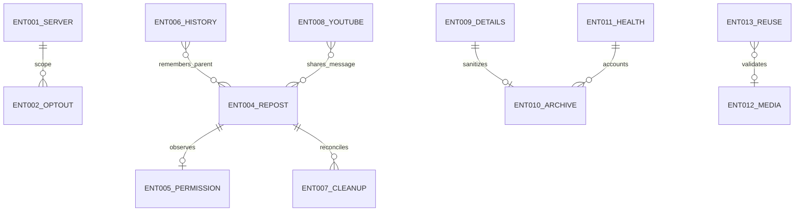

# Data Contracts — Linky

Related: [SRS](SRS.md) · [Architecture](ARCHITECTURE.md)

ADOPT baseline `1a69229`, 2026-11-26. v1.0.0 versions this documentation, not an invented on-disk version marker. Native versions are specified separately. No live state/environment values or real resource identities were read.

## 1. Conventions
Application fields use camelCase; Discord retains native snake_case. Snowflakes are validated decimal strings, never floating-point numbers. Time is integer epoch milliseconds unless a provider explicitly uses ISO8601; report days use UTC. Duration is milliseconds; MiB=1,048,576 bytes. Optional means absent allowed; absent and empty channel scope differ. No money storage exists; localized UI counts do not change stored types. Public source posts do not make operational identity bindings public.

## 2. Versioning and compatibility
Optional additive changes increment minor. Removing/renaming fields, changing type/meaning or adding required fields increments major and requires §9 migration/deprecation notes. Current strict authority readers may reject unknown fields: do not assume permissive unknown-field behavior. Retain legacy readers until safe restore is available. No universal deprecation duration is implemented (TBD-S0-004). Signed regional peers must use exact canonical protocol v3;custom ids are untrusted routing, never authority.

## 3. Entities
Paths are relative to the settings directory (default `data/`) except configured media/reuse directories. Optional suffix `?` means absent allowed; all other named fields are required in the appropriate representation. Finite enums and detailed validation are owned by linked source parsers. In-memory provider caches, manual/gallery session bindings, reply snapshots and scheduler/provider-health state are not durable entities. Atomic temporary files, quarantines and staging bytes are artifacts rather than additional authority stores.

### ENT-001 — Server preferences (v1.0.0)
System of record: CMP-065 ([source](../src/services/ServerSettings.ts)). File: `servers.json`. Retention: No timed expiry; operator-managed.

| Field | Type | Required | Constraints | Classification | Description |
|---|---|---|---|---|---|
| server key | snowflake | yes | Validated map key | PII / internal | Owner parser field |
| enabled | boolean | no | Explicit activation | PII / internal | Owner parser field |
| mode | enum | no | replace/reply | PII / internal | Owner parser field |
| platforms | map<boolean> | no | Known platform keys | PII / internal | Owner parser field |
| translateTweets, replies | boolean | no | Replies absent=off | PII / internal | Owner parser field |
| channelIds | snowflake[] | no | Unique<=25;empty means none | PII / internal | Owner parser field |
| youtubeDisplay | enum | no | preview/counts/counts-and-comment | PII / internal | Owner parser field |
| eromeChannels | enum | no | age-restricted/all | PII / internal | Owner parser field |

Serialized shape: Map server snowflake -> legacy boolean or object: enabled?,mode?(replace/reply), platforms?(known-name: boolean), translateTweets?,replies?,channelIds?,youtubeDisplay?(preview/counts/counts-and-comment), eromeChannels?(age-restricted/all).

Recovery/quarantine: Invalid/unreadable fails loading; no quarantine.

Relationships: Independent store; logical joins use validated attempt/asset/resource identities.

Invariants: File presence does not grant current Discord access; only the owner validates/serializes this state. Retired translateInstagram/instagramPresentation load but next save drops them.

### ENT-002 — Personal opt-outs (v1.0.0)
System of record: CMP-045 ([source](../src/services/PersonalPreferences.ts)). File: `personal-preferences.json`. Retention: Until re-enabled/bot leaves; ready removes unjoined servers.

| Field | Type | Required | Constraints | Classification | Description |
|---|---|---|---|---|---|
| server key | snowflake | yes | Map key | PII / internal | Owner parser field |
| value | snowflake[] | yes | Unique nonempty opt-outs | PII / internal | Owner parser field |

Serialized shape: Map server snowflake -> nonempty unique member snowflake array.

Recovery/quarantine: Invalid/unreadable fails loading; no quarantine.

Relationships: Independent store; logical joins use validated attempt/asset/resource identities.

Invariants: File presence does not grant current Discord access; only the owner validates/serializes this state.

### ENT-003 — Service checkpoint (v1.0.0)
System of record: CMP-066 ([source](../src/services/ServiceCheckpoint.ts)). File: `service-checkpoint.json`. Retention: Latest snapshot; recovery within 2 minutes.

| Field | Type | Required | Constraints | Classification | Description |
|---|---|---|---|---|---|
| stoppedAt, aliveAt | integer | no | Nonnegative epoch ms | PII / internal | Owner parser field |
| channels | snowflake[] | yes | Unique<=20 newest first | PII / internal | Owner parser field |

Serialized shape: stoppedAt?,aliveAt? nonnegative safe epoch ms; channels unique snowflake array newest first.

Recovery/quarantine: Invalid/missing disables one restart recovery; no quarantine.

Relationships: Independent store; logical joins use validated attempt/asset/resource identities.

Invariants: File presence does not grant current Discord access; only the owner validates/serializes this state.

### ENT-004 — Repost ownership/intents (v1.0.0)
System of record: CMP-063 ([source](../src/services/RepostRegistry.ts)). File: `reposts.json`. Retention: 30 days by replacement age; cleanup/permission grace rules apply.

| Field | Type | Required | Constraints | Classification | Description |
|---|---|---|---|---|---|
| records | object[] | yes | Unique source/replacement | PII / internal | Owner parser field |
| records[].guildId, channelId, sourceId, replacementId, authorId | snowflake | yes | Valid Discord identity | PII / internal | Owner parser field |
| records[].mode | enum | yes | reply/replace | PII / internal | Owner parser field |
| remove, refresh | snowflake[] | yes | Unique referenced replacements; refresh reply-only | PII / internal | Owner parser field |

Serialized shape: records: [guildId, channelId, sourceId, replacementId, authorId snowflakes; mode replace/reply]; remove, refresh unique replacement-id arrays.

Recovery/quarantine: Malformed authority fails closed; no quarantine.

Relationships: Shares validated parent/message identity with ENT-004 and independent cleanup/media bindings; no foreign-key enforcement.

Invariants: File presence does not grant current Discord access; only the owner validates/serializes this state.

### ENT-005 — Permission observations (v1.0.0)
System of record: CMP-063 ([source](../src/services/RepostRegistry.ts)). File: `reposts-permission.json`. Retention: Only registered replacements;24-hour permission-failure grace.

| Field | Type | Required | Constraints | Classification | Description |
|---|---|---|---|---|---|
| replacement key | snowflake | yes | Registered replacement | PII / internal | Owner parser field |
| value | integer | yes | Nonnegative first-failure epoch ms | PII / internal | Owner parser field |

Serialized shape: Map replacement snowflake -> first continuous permission-failure epoch ms.

Recovery/quarantine: Malformed/unreadable observations discarded without blocking ownership.

Relationships: Shares validated parent/message identity with ENT-004 and independent cleanup/media bindings; no foreign-key enforcement.

Invariants: File presence does not grant current Discord access; only the owner validates/serializes this state.

### ENT-006 — Reply creation history (v1.0.0)
System of record: CMP-056 ([source](../src/services/ReplyCreationHistory.ts)). File: `reply-creation-history.json`. Retention: Oldest snowflakes evicted at capacity; explicit cleanup forget.

| Field | Type | Required | Constraints | Classification | Description |
|---|---|---|---|---|---|
| root | snowflake[] | yes | Parent identities | PII / internal | Owner parser field |

Serialized shape: Array of parent snowflakes reserved durably before thread creation.

Recovery/quarantine: Rename .corrupt-<time>;failed quarantine disables new creation; write failure pauses one minute.

Relationships: Shares validated parent/message identity with ENT-004 and independent cleanup/media bindings; no foreign-key enforcement.

Invariants: File presence does not grant current Discord access; only the owner validates/serializes this state.

### ENT-007 — Reply cleanup intent (v1.0.0)
System of record: CMP-054 ([source](../src/services/ReplyCleanupJournal.ts)). File: `reply-cleanup.json`. Retention: Until confirmed cleanup; sweep50/minute.

| Field | Type | Required | Constraints | Classification | Description |
|---|---|---|---|---|---|
| root[].guildId, channelId, threadId | snowflake | yes | Exactly three keys | PII / internal | Owner parser field |

Serialized shape: Array of exact objects guildId, channelId, threadId snowflakes.

Recovery/quarantine: Attempt .corrupt-<time> rename; warn/start empty even if rename fails.

Relationships: Shares validated parent/message identity with ENT-004 and independent cleanup/media bindings; no foreign-key enforcement.

Invariants: File presence does not grant current Discord access; only the owner validates/serializes this state.

### ENT-008 — YouTube expiry (v1.0.0)
System of record: CMP-084 ([source](../src/services/YouTubeStats.ts)). File: `youtube-stats.json`. Retention: 24-hour access; failed cleanup through 7 days after expiry.

| Field | Type | Required | Constraints | Classification | Description |
|---|---|---|---|---|---|
| channelId, messageId | snowflake | yes | Unique messageId | PII / internal | Owner parser field |
| expiresAt | integer | yes | Nonnegative epoch ms | PII / internal | Owner parser field |
| kind | enum | no | controls/card; absent legacy | PII / internal | Owner parser field |
| videoIds | string[] | controls | 1-3 unique11-character ids | PII / internal | Owner parser field |
| baseMessageId | snowflake | no | Legacy card only | PII / internal | Owner parser field |
| baseLength, suffixLength | integer | legacy | Total<=2000;suffix>=4 | PII / internal | Owner parser field |

Serialized shape: Array: channelId, messageId snowflakes; expiresAt safe epoch ms; kind? controls/card; controls videoIds1-3 unique11-char; card baseMessageId?;legacy baseLength, suffixLength total<=2000,suffix>=4.

Recovery/quarantine: Invalid/unreadable fails loading; no quarantine.

Relationships: Shares validated parent/message identity with ENT-004 and independent cleanup/media bindings; no foreign-key enforcement.

Invariants: File presence does not grant current Discord access; only the owner validates/serializes this state.

### ENT-009 — Private diagnostics (v1.0.0)
System of record: CMP-018 ([source](../src/services/DeliveryDiagnostics.ts)). File: `delivery-diagnostics.json`. Retention: 7 days; periodic/on-access prune; oldest capacity eviction.

| Field | Type | Required | Constraints | Classification | Description |
|---|---|---|---|---|---|
| version | integer | yes | 1 | PII / internal | Owner parser field |
| attempts | object[] | yes | Bounded attempt array | PII / internal | Owner parser field |
| attempts[].id | UUIDv4 | yes | Attempt correlation | PII / internal | Owner parser field |
| requesterId, channelId | snowflake | yes | Access binding | PII / internal | Owner parser field |
| guildId, messageId | snowflake | no | Optional context/publication | PII / internal | Owner parser field |
| mode, platform | enum | yes | Finite catalogs | PII / internal | Owner parser field |
| startedAt | integer | yes | Epoch ms | PII / internal | Owner parser field |
| path, cache, outcome, durationMs | enum/number | no | Finite catalogs and0..one-day duration | PII / internal | Owner parser field |
| stages | object[] | yes | stage, durationMs, outcome, itemIndex?;<=96 | PII / internal | Owner parser field |

Serialized shape: id UUIDv4;requesterId, channelId snowflakes; guildId?,messageId?;mode automatic/manual; platform; startedAt; path?,cache? hit/miss, outcome?,durationMs?;stages<=96 of stage, durationMs, outcome, itemIndex?0..100.

Recovery/quarantine: Invalid records ignored; allowlisted fields only; unfinished becomes interrupted.

Relationships: Shares validated parent/message identity with ENT-004 and independent cleanup/media bindings; no foreign-key enforcement.

Invariants: File presence does not grant current Discord access; only the owner validates/serializes this state.

### ENT-010 — Sanitized archive (v1.0.0)
System of record: CMP-014 ([source](../src/services/DeliveryArchive.ts)). File: `delivery-logs/YYYY-MM-DD.jsonl`. Retention: Default30 days, operator1-90;oldest-day capacity eviction.

| Field | Type | Required | Constraints | Classification | Description |
|---|---|---|---|---|---|
| id | UUIDv4 | yes | Dedup attempt | internal | Owner parser field |
| startedAt | integer | yes | UTC epoch ms | internal | Owner parser field |
| mode, platform, outcome | enum | yes | Finite catalogs | internal | Owner parser field |
| path, cache, durationMs | enum/number | no | Finite categories/bounded duration | internal | Owner parser field |
| stages | object[] | yes | Sanitized spans; no identities | internal | Owner parser field |

Serialized shape: id UUIDv4,startedAt epoch ms, platform, mode, outcome, path?,cache?,durationMs?,stages finite allowlisted spans; no Discord identities/URLs/content.

Recovery/quarantine: Invalid lines skipped/counted; corrupt/oversized managed files count toward cap.

Relationships: Independent store; logical joins use validated attempt/asset/resource identities.

Invariants: File presence does not grant current Discord access; only the owner validates/serializes this state.

### ENT-011 — Archive health (v1.0.0)
System of record: CMP-014 ([source](../src/services/DeliveryArchive.ts)). File: `delivery-logs/health.json`. Retention: Lifetime counters; observed days within retention.

| Field | Type | Required | Constraints | Classification | Description |
|---|---|---|---|---|---|
| version | integer | yes | 1 | internal | Owner parser field |
| firstStartedAt, updatedAt | integer | yes | Epoch ms | internal | Owner parser field |
| retentionDays, maxBytes | integer | yes | Effective bounded configuration | internal | Owner parser field |
| counters | map<integer> | yes | Nonnegative catalog counters | internal | Owner parser field |
| observedDays | object[] | yes | day, firstSeenAt, lastSeenAt; max 91 | internal | Owner parser field |

Serialized shape: version1;firstStartedAt, updatedAt; retentionDays, maxBytes; counters written/duplicates/queueDrops/invalidDrops/expiredDrops/closedDrops/writeErrors/capacityFiles/invalidLines/readErrors/closeTimeouts; observedDays<=91 of day, firstSeenAt, lastSeenAt.

Recovery/quarantine: Invalid health means unknown coverage; no quarantine.

Relationships: Independent store; logical joins use validated attempt/asset/resource identities.

Invariants: File presence does not grant current Discord access; only the owner validates/serializes this state.

### ENT-012 — Hosted media files/metadata (v1.0.0)
System of record: CMP-039 ([source](../src/services/MediaAssetStore.ts)). File: `media/<asset>.json and media/<asset>.<extension>`. Retention: While references exist; unbound orphan15 minutes; durable deletion intent.

| Field | Type | Required | Constraints | Classification | Description |
|---|---|---|---|---|---|
| version | integer | yes | 1/2 | PII / internal | Owner parser field |
| id, sha256 | hex string | yes | 32/64 lowercase hex | PII / internal | Owner parser field |
| size, createdAt | integer | yes | Positive bounded bytes/nonnegative epoch | PII / internal | Owner parser field |
| mimeType | enum | v2 | video/mp4,image/jpeg, image/png | PII / internal | Owner parser field |
| messages | snowflake[] | yes | Unique<=64 | PII / internal | Owner parser field |
| deleting | boolean | yes | True requires no references | PII / internal | Owner parser field |

Serialized shape: version1/2;id32hex, size, sha25664hex, createdAt, messages unique snowflakes<=64,deleting boolean; v2 mimeType video/mp4,image/jpeg, image/png; v1 inferred MP4.

Recovery/quarantine: Unsafe directory rejected; invalid/ambiguous pairs unavailable or block admission; no blind authority reset.

Relationships: Shares validated parent/message identity with ENT-004 and independent cleanup/media bindings; no foreign-key enforcement.

Invariants: File presence does not grant current Discord access; only the owner validates/serializes this state.

### ENT-013 — Media reuse index (v1.0.0)
System of record: CMP-040 ([source](../src/services/MediaReuseIndex.ts)). File: `erome-reuse/index.json`. Retention: 7 days since use; startup/activity/minute prune.

| Field | Type | Required | Constraints | Classification | Description |
|---|---|---|---|---|---|
| version | integer | yes | 1 | confidential | Owner parser field |
| secret | hex string | yes | Private32-byte HMAC salt | confidential | Owner parser field |
| entries | object[] | yes | <=1024 descriptors | confidential | Owner parser field |
| entries[].key, id, sha256 | hex string | yes | 64/32/64 lowercase hex | confidential | Owner parser field |
| lastUsed, size | integer | yes | Epoch ms/positive bounded bytes | confidential | Owner parser field |
| mimeType | enum | yes | Allowed media type | confidential | Owner parser field |
| metadata | object | yes | width, height; duration/fps for video | confidential | Owner parser field |

Serialized shape: version1;secret private32-byte hex HMAC salt; entries of key, lastUsed, id, size, sha256,mimeType, metadata(width, height, duration?,fps?); no source URLs.

Recovery/quarantine: Unsafe directory rejects; invalid file/write failure disables reuse without overwriting existing state.

Relationships: Independent store; logical joins use validated attempt/asset/resource identities.

Invariants: File presence does not grant current Discord access; only the owner validates/serializes this state.

### ENT-014 — Prompt jobs (v1.0.0)
System of record: CMP-048 ([source](../src/services/PromptService.ts)). File: `prompt-jobs.json`. Retention: Completed14 days on next write; active/uncertain retained.

| Field | Type | Required | Constraints | Classification | Description |
|---|---|---|---|---|---|
| id, guildId, userId | snowflake | yes | Interaction/server/requester | PII / internal | Owner parser field |
| createdAt | number | yes | Finite epoch ms | PII / internal | Owner parser field |
| state | enum | yes | queued/running/succeeded/failed/uncertain | PII / internal | Owner parser field |
| runId | integer | no | GitHub run | PII / internal | Owner parser field |
| runUrl, prUrl | URL | no | Fixed repository progress links | PII / internal | Owner parser field |

Serialized shape: Array: id, guildId, userId snowflakes; createdAt; state queued/running/succeeded/failed/uncertain; runId?,runUrl?,prUrl?;no request text.

Recovery/quarantine: Invalid/unreadable fails loading; no quarantine.

Relationships: Independent store; logical joins use validated attempt/asset/resource identities.

Invariants: File presence does not grant current Discord access; only the owner validates/serializes this state.

### 3.15 Entity relationship overview

ENT-003 checkpoint and ENT-014 prompt state are independent. Diagram links are logical associations;§3 ids own definitions.

## 4. Operations (APIs)
Entries here are **exposed**;§7 separately identifies **consumed** integrations. Discord caller/message context comes from Discord, not embedded trusted user/channel ids. Allowed mentions are suppressed by delivery paths. Satisfies: subsequent area matrices in SRS §5.1 map requirements to these contracts; no requirement ids are allocated here.

### API-001 — Help (v1.0.0)
Direction: **exposed**. Style: Discord RPC. Endpoint: `/help`. Owner/consumer: CMP-089.

Auth: Supported install/context. Request: No options.

Response: Private usage card. Errors / idempotency / pagination / rate limits: Read-only; unsupported context explained. Source: owning module in Architecture §4.

### API-002 — Setup (v1.0.0)
Direction: **exposed**. Style: Discord RPC. Endpoint: `/setup`. Owner/consumer: CMP-093.

Auth: Owner/Administrator/Manage Server. Request: Optional enabled: boolean; omitted opens panel.

Response: Private scope/readiness/saved choice. Errors / idempotency / pagination / rate limits: Omitted does not enable; save failure retains choice. Source: owning module in Architecture §4.

### API-003 — Settings (v1.0.0)
Direction: **exposed**. Style: Discord RPC. Endpoint: `/settings`. Owner/consumer: CMP-092.

Auth: Guild admin gate. Request: Optional mode replace/reply; instagram, tiktok, x, youtube, bluesky, reddit, twitch, facebook, articles, erome, replies, translate_tweets booleans; erome_channels age-restricted/all; youtube_display preview/counts/counts-and-comment.

Response: Private read/saved patch. Errors / idempotency / pagination / rate limits: Cannot enable operator-disabled feature; no options reads. Source: owning module in Architecture §4.

### API-004 — Personal automatic fixing (v1.0.0)
Direction: **exposed**. Style: Discord RPC. Endpoint: `/autofix`. Owner/consumer: CMP-085.

Auth: Own guild preference. Request: Optional enabled: boolean.

Response: Private current choice/saved opt-out. Errors / idempotency / pagination / rate limits: Repeated choice no-op; no old scan; full/failed store explained. Source: owning module in Architecture §4.

### API-005 — Diagnose (v1.0.0)
Direction: **exposed**. Style: Discord RPC. Endpoint: `/diagnose`. Owner/consumer: CMP-086.

Auth: Contextual member access. Request: Optional HTTPS link: string.

Response: Private scope/permission/support observations. Errors / idempotency / pagination / rate limits: Read-only; no public post/arbitrary lookup. Source: owning module in Architecture §4.

### API-006 — Manual preview (v1.0.0)
Direction: **exposed**. Style: Discord RPC. Endpoint: `/fix`. Owner/consumer: CMP-087.

Auth: Guild/user install, permissions/upload allowance/Erome policy. Request: Required link: string<=1500;up to 3 supported links or5 community posts within shared card limits.

Response: Preview or private failure/guidance. Errors / idempotency / pagination / rate limits: Always keep source; requester owns Remove; mixed unsupported sets explained. Source: owning module in Architecture §4.

### API-007 — Message context action (v1.0.0)
Direction: **exposed**. Style: Discord RPC. Endpoint: `Fix with Linky`. Owner/consumer: CMP-087.

Auth: Supported guild/user context. Request: Discord-resolved target message.

Response: Same manual policy as /fix. Errors / idempotency / pagination / rate limits: No trusted id from custom_id; keep source. Source: owning module in Architecture §4.

### API-008 — Coding request (v1.0.0)
Direction: **exposed**. Style: Discord RPC. Endpoint: `/prompt`. Owner/consumer: CMP-090.

Auth: Manage Server; operator-approved/enabled guild. Request: Optional request: string10-3000;omitted reads latest.

Response: Private status; submitted text public GitHub input. Errors / idempotency / pagination / rate limits: One active global,3/day UTC,30-minute requester cooldown; reserve before dispatch. Source: owning module in Architecture §4.

### API-009 — Setup selections (v1.0.0)
Direction: **exposed**. Style: Discord RPC. Endpoint: `linky:setup:mode / platforms / channels`. Owner/consumer: CMP-094.

Auth: Same admin gate. Request: Enum/known platforms/up to 25 channels.

Response: Private saved panel. Errors / idempotency / pagination / rate limits: Serialized changes; invalid/save failure retains state. Source: owning module in Architecture §4.

### API-010 — Setup actions (v1.0.0)
Direction: **exposed**. Style: Discord RPC. Endpoint: `linky:setup:enable / disable / all-channels / test`. Owner/consumer: CMP-094.

Auth: Admin; test also current delivery permissions. Request: Button.

Response: Private panel; explicit Test here can post sample. Errors / idempotency / pagination / rate limits: 30-second channel test cooldown,64 tracked channels; enabled X/YouTube sample required. Source: owning module in Architecture §4.

### API-011 — Automatic Remove/Retry (v1.0.0)
Direction: **exposed**. Style: Discord RPC. Endpoint: `linky:remove / linky:retry`. Owner/consumer: CMP-063.

Auth: Remove sharer-only; Retry current view/send/no-timeout. Request: Bound bot message and caller.

Response: Delete preview/related resources or regenerate retaining source. Errors / idempotency / pagination / rate limits: Up to30-day ownership; source lock; unavailable/denied private. Source: owning module in Architecture §4.

### API-012 — Manual Remove (v1.0.0)
Direction: **exposed**. Style: Discord RPC. Endpoint: `linky:remove-manual`. Owner/consumer: CMP-087.

Auth: Bound requester-only. Request: Discord context.

Response: Delete manual preview. Errors / idempotency / pagination / rate limits: Memory binding expires/restarts; unowned denied. Source: owning module in Architecture §4.

### API-013 — Delivery details (v1.0.0)
Direction: **exposed**. Style: Discord RPC. Endpoint: `linky:details:<uuid>`. Owner/consumer: CMP-017.

Auth: Bound public guild message: viewer; private/DM:requester. Request: Attempt UUIDv4.

Response: Private finite outcome/timing. Errors / idempotency / pagination / rate limits: ENT-009 retention/cap; unbound unavailable. Source: owning module in Architecture §4.

### API-014 — Load album item (v1.0.0)
Direction: **exposed**. Style: Discord RPC. Endpoint: `linky:album:<sessionId>`. Owner/consumer: CMP-023.

Auth: Current view/send/no-timeout; bound gallery. Request: Opaque session.

Response: Append one validated item. Errors / idempotency / pagination / rate limits: 24-hour memory session; restart expiry; max 10/192 MiB; failure retains existing. Source: owning module in Architecture §4.

### API-015 — YouTube count/comment (v1.0.0)
Direction: **exposed**. Style: Discord RPC. Endpoint: `linky:yt:stats:<videoId> / linky:yt:comment:<videoId>`. Owner/consumer: CMP-082.

Auth: Unexpired bound bot message/video. Request: 11-character video id.

Response: Private exact counts/attributed comment. Errors / idempotency / pagination / rate limits: 24-hour access; provider/missing fields explained. Source: owning module in Architecture §4.

### API-016 — YouTube comments thread (v1.0.0)
Direction: **exposed**. Style: Discord RPC. Endpoint: `linky:yt:replies:<videoId>`. Owner/consumer: CMP-058.

Auth: Replies enabled; eligible parent/thread permissions. Request: Bound11-character video.

Response: Public comments thread. Errors / idempotency / pagination / rate limits: Parent lock/history; moderator removal respected. Source: owning module in Architecture §4.

### API-017 — X replies thread (v1.0.0)
Direction: **exposed**. Style: Discord RPC. Endpoint: `linky:replies:x:<statusId>:<handle>`. Owner/consumer: CMP-058.

Auth: Replies enabled; tracked parent; guild/thread permissions. Request: Status 1-20 digits; handle 1-15 word/underscore.

Response: Public bounded replies thread. Errors / idempotency / pagination / rate limits: Parent lock/history; missing/private error. Source: owning module in Architecture §4.

### API-018 — Bluesky replies thread (v1.0.0)
Direction: **exposed**. Style: Discord RPC. Endpoint: `linky:replies:bsky:<identity>`. Owner/consumer: CMP-058.

Auth: Same thread gate. Request: Validated DID/rkey parsePostId identity; custom_id<=100.

Response: Public replies thread. Errors / idempotency / pagination / rate limits: Parent lock/history; invalid identity denied. Source: owning module in Architecture §4.

### API-019 — LinkedIn comments thread (v1.0.0)
Direction: **exposed**. Style: Discord RPC. Endpoint: `linky:replies:linkedin:<activityId>`. Owner/consumer: CMP-058.

Auth: Same thread gate; parent comments address validated. Request: Activity15-22 digits.

Response: Public signed-out comments. Errors / idempotency / pagination / rate limits: No arbitrary URL from button; unavailable explained. Source: owning module in Architecture §4.

### API-020 — Prompt status (v1.0.0)
Direction: **exposed**. Style: Discord RPC. Endpoint: `prompt-status:<interactionId>`. Owner/consumer: CMP-090.

Auth: Same approved guild admin gate. Request: Job identity.

Response: Private reconciled state. Errors / idempotency / pagination / rate limits: Read/reconcile never redispatch; last known state on failure. Source: owning module in Architecture §4.

### API-021 — Hosted media read (v1.0.0)
Direction: **exposed**. Style: HTTP/SDK. Endpoint: `GET or HEAD /media/<32-hex>.(mp4,jpg,png)`. Owner/consumer: CMP-041.

Auth: Opaque registered asset; never origin fetch. Request: Single Range bytes=start-end/suffix; If-Range ETag; no body.

Response: 200/206 MIME, length, ETag, ranges; no-store/noindex/nosniff. Errors / idempotency / pagination / rate limits: 404 absent/extension;405 method;413 body;416 range;429 saturation;503 I/O;20 seconds;8 active media,64 connections,8 KiB/24 headers. Source: owning module in Architecture §4.

### API-022 — Local health (v1.0.0)
Direction: **exposed**. Style: HTTP/SDK. Endpoint: `/healthz`. Owner/consumer: CMP-041.

Auth: Direct loopback; no forwarding headers. Request: Path.

Response: 200 local;404 public/proxied; empty body. Errors / idempotency / pagination / rate limits: Read-only; listener only when media enabled. Source: owning module in Architecture §4.

### API-023 — Regional claim (v1.0.0)
Direction: **exposed**. Style: HTTP/SDK. Endpoint: `POST /internal/regional/claim`. Owner/consumer: CMP-041.

Auth: x-linky-signature claim HMAC/exact live job. Request: Canonical v3 JSON<=4096;Content-Length; no transfer encoding.

Response: 204 claim once. Errors / idempotency / pagination / rate limits: 403 invalid/expired/used;405 method;429 saturation;503 failure; body2 seconds, HTTP20,10 active claims. Source: owning module in Architecture §4.

### API-024 — Regional worker (v1.0.0)
Direction: **exposed**. Style: HTTP/SDK. Endpoint: `POST /api/{iad,fra,lhr,cle,sfo,cdg,dub,pdx,yul}`. Owner/consumer: CMP-053.

Auth: Route-domain HMAC; exact deployed region. Request: Canonical exact fields v=3,id32hex, part, source, album, etag, bytes, issuedAt, expiresAt;4096 bytes; max 30-second life,5-second clock margin; no query/cookie/Range.

Response: Exact part stream after coordinator claim. Errors / idempotency / pagination / rate limits: 400 shape;401 signature;403 claim;502 source;503 config/region;504 deadline;8 seconds;24 MiB object,4 MiB part;10 partitions including local. Source: owning module in Architecture §4.

### API-025 — Truth relay (v1.0.0)
Direction: **exposed**. Style: HTTP/SDK. Endpoint: `GET /status/<numericId>`. Owner/consumer: CMP-104.

Auth: Bearer configured secret>=32 chars. Request: Id 1-20 digits; no query.

Response: JSON, no-store; upstream200 edge-cache60 seconds. Errors / idempotency / pagination / rate limits: 401 auth;404 path/post;410 gone;405 method;502 upstream/type/oversize;503 config;512 KiB after arrayBuffer; no explicit worker timer/stream cap (TBD-S0-003). Source: owning module in Architecture §4.

### API-026 — Archive report (v1.0.0)
Direction: **exposed**. Style: CLI. Endpoint: `npm run report:deliveries -- [--days N] [--json] [--directory PATH]`. Owner/consumer: CMP-014.

Auth: Local operator. Request: Days1-90,default 7.

Response: Text/JSON counts, timing, coverage/loss; exit0/1. Errors / idempotency / pagination / rate limits: Read-only; dedup attempt ids; invalid args/read sanitized. Source: owning module in Architecture §4.

### API-027 — Details report (v1.0.0)
Direction: **exposed**. Style: CLI. Endpoint: `node ops/delivery-report.mjs [--file PATH] [--since ISO] [--min-completed N] [--platform P] [--path P] [--cache hit/miss] [--require predicate] [--reject-outcome O]`. Owner/consumer: CMP-018.

Auth: Local operator. Request: Filters/repeatable evidence predicates.

Response: JSON aggregates/gate exit. Errors / idempotency / pagination / rate limits: Read-only; invalid input/failed gate nonzero. Source: owning module in Architecture §4.

### API-028 — Provider metadata check (v1.0.0)
Direction: **exposed**. Style: CLI. Endpoint: `npm run check:providers -- [--corpus PATH] [--json] [--timeout MS] [URL ...]`. Owner/consumer: CMP-069.

Auth: Operator/public network. Request: Built app/corpus/supported URLs.

Response: Qualified provider metadata observations. Errors / idempotency / pagination / rate limits: Bounded checker; does not prove Discord rendering/playback. Source: owning module in Architecture §4.

### API-029 — Local validation (v1.0.0)
Direction: **exposed**. Style: CLI. Endpoint: `npm run validate`. Owner/consumer: CMP-002.

Auth: Operator toolchain. Request: Checkout/dependencies.

Response: Sequential validation status. Errors / idempotency / pagination / rate limits: Build/test/audit; failed subprocess prevents success. Source: owning module in Architecture §4.

### API-030 — Register commands (v1.0.0)
Direction: **exposed**. Style: CLI. Endpoint: `npm run register-commands`. Owner/consumer: CMP-091.

Auth: Operator Discord credential. Request: Current app resolved by REST; no options.

Response: Replace global commandDefinitions. Errors / idempotency / pagination / rate limits: Repeated PUT same schema; missing token/REST exits1. Source: owning module in Architecture §4.

### API-031 — Tested revision deploy (v1.0.0)
Direction: **exposed**. Style: CLI. Endpoint: `bash ops/deploy.sh <fullRevision>`. Owner/consumer: CMP-097.

Auth: Host operator; ssh-deploy accepts deploy plus40hex revision. Request: Tested revision.

Response: Startup/Discord confirmation and revision marker. Errors / idempotency / pagination / rate limits: Deployment lock; failed startup rollback; never blindly repeat ambiguous SSH. Source: owning module in Architecture §4.

### API-032 — Prompt workflow controls (v1.0.0)
Direction: **exposed**. Style: CLI. Endpoint: `node ops/prompt-workflow.mjs prepare/review/publish [candidate] [review] [binding]`. Owner/consumer: CMP-048.

Auth: Trusted workflow; separate scoped credentials. Request: prepare inputs; review candidate; publish candidate/review/binding.

Response: Trusted prompts/guarded publication. Errors / idempotency / pagination / rate limits: Invalid paths/binding/review/check/deploy denies success. Source: owning module in Architecture §4.

### API-033 — Candidate export (v1.0.0)
Direction: **exposed**. Style: CLI. Endpoint: `node ops/prompt-candidate.mjs export COMMIT_SHA`. Owner/consumer: CMP-048.

Auth: Trusted local checkout. Request: Baseline revision.

Response: JSON stdout. Errors / idempotency / pagination / rate limits: Invalid paths/patch cap fails; no publishing credential. Source: owning module in Architecture §4.

### API-034 — PR evidence check (v1.0.0)
Direction: **exposed**. Style: CLI. Endpoint: `node ops/pr-evidence-check.mjs [eventFile]`. Owner/consumer: CMP-002.

Auth: Trusted CI/operator. Request: Event JSON or GITHUB_EVENT_PATH.

Response: Exit0 with required evidence. Errors / idempotency / pagination / rate limits: Missing/invalid evidence fails; base checker in CI. Source: owning module in Architecture §4.

## 5. Error model
No universal public REST envelope exists. Discord uses ephemeral human-readable explanations; adapters use null/unavailable/finite outcomes and preserve sources. Regional workers use HTTP statuses/finite errors; media errors generally have empty bodies. CLIs use documented text/JSON and nonzero exits. PromptError represents admission errors. Instrumented attempt UUID correlates local details; no distributed trace id is promised. Safe logging omits arbitrary raw error messages/stacks/URLs/bodies/credentials.

## 6. Events and messages
Producer: Discord/discord.js. Delivery is best-effort gateway/lifecycle notification, not exactly-once; events can duplicate or be missed. Source/channel serialization and durable intents reconcile; optional checkpoint is bounded catch-up, not complete replay. Requirement mappings live in subsequent area matrices.

### EVT-001 — messageCreate (v1.0.0)
Producer: Discord/discord.js. Consumer: CMP-002. Channel: existing Discord client. Delivery: best-effort; missed/duplicate events possible. Ordering key: source/channel where present, otherwise client/server. Payload: Member content, attachments, author, context, flags. Handling: Automatic eligibility; ignore bots/webhooks/suppression. Satisfies: subsequent area matrices. Source: `src/bot.ts`.

### EVT-002 — messageUpdate (v1.0.0)
Producer: Discord/discord.js. Consumer: CMP-002. Channel: existing Discord client. Delivery: best-effort; missed/duplicate events possible. Ordering key: source/channel where present, otherwise client/server. Payload: Before/after possibly partial message. Handling: Preview confirmation and recorded reply sync; unrelated old edits never initiate. Satisfies: subsequent area matrices. Source: `src/bot.ts`.

### EVT-003 — messageDelete (v1.0.0)
Producer: Discord/discord.js. Consumer: CMP-002. Channel: existing Discord client. Delivery: best-effort; missed/duplicate events possible. Ordering key: source/channel where present, otherwise client/server. Payload: Identity/context, possibly partial. Handling: Cancel, ownership cleanup, asset release. Satisfies: subsequent area matrices. Source: `src/bot.ts`.

### EVT-004 — messageDeleteBulk (v1.0.0)
Producer: Discord/discord.js. Consumer: CMP-002. Channel: existing Discord client. Delivery: best-effort; missed/duplicate events possible. Ordering key: source/channel where present, otherwise client/server. Payload: Deleted message collection. Handling: Per-message cleanup. Satisfies: subsequent area matrices. Source: `src/bot.ts`.

### EVT-005 — interactionCreate (v1.0.0)
Producer: Discord/discord.js. Consumer: CMP-002. Channel: existing Discord client. Delivery: best-effort; missed/duplicate events possible. Ordering key: source/channel where present, otherwise client/server. Payload: Resolved command/component/context, caller, permissions. Handling: Validated dispatch. Satisfies: subsequent area matrices. Source: `src/bot.ts`.

### EVT-006 — guildDelete (v1.0.0)
Producer: Discord/discord.js. Consumer: CMP-002. Channel: existing Discord client. Delivery: best-effort; missed/duplicate events possible. Ordering key: source/channel where present, otherwise client/server. Payload: Server identity. Handling: Remove personal opt-outs on leave. Satisfies: subsequent area matrices. Source: `src/bot.ts`.

### EVT-007 — clientReady (v1.0.0)
Producer: Discord/discord.js. Consumer: CMP-002. Channel: existing Discord client. Delivery: best-effort; missed/duplicate events possible. Ordering key: source/channel where present, otherwise client/server. Payload: Bot identity/joined guild collection. Handling: Initialize persisted services/reconciliation/catch-up. Satisfies: subsequent area matrices. Source: `src/bot.ts`.

### EVT-008 — error (v1.0.0)
Producer: Discord/discord.js. Consumer: CMP-002. Channel: existing Discord client. Delivery: best-effort; missed/duplicate events possible. Ordering key: source/channel where present, otherwise client/server. Payload: Client error. Handling: Safe logging. Satisfies: subsequent area matrices. Source: `src/bot.ts`.

## 7. External integration contracts
The following operations are **consumed**, separate from exposed §4 operations. Fixed providers use parsed identities, not arbitrary member-selected endpoint origins. General articles/PDFs explicitly validate public destinations and pin DNS on every hop. No member cookies/login credentials are forwarded. Intended operator API keys/bot credentials/HMAC/relay authorization are narrow integration exceptions. Discord unfurlers may independently fetch catalog URLs. No upstream SLA is inferred. Credential values, host addresses and live identifiers are excluded.

### API-035 — Discord gateway and REST (v1.0.0)
Direction: **consumed**. Style: HTTP/SDK. Endpoint: `Discord gateway and REST v10`. Consumer: CMP-002.

Auth: Bot/interaction credentials only at Discord. Request: Messages, channels, threads, permissions, commands, interaction webhooks.

Response: Native objects/events. Timeout / redirects / byte caps / failure behavior: SDK owns reconnect/rate limits; no universal application timeout/byte cap; individual operations bounded where coded. Idempotency/pagination/rate limits: as stated above; GET reads do not mutate origin. Satisfies: future area matrices. Source: owning module in Architecture §4.

### API-036 — FxEmbed status (v1.0.0)
Direction: **consumed**. Style: HTTP/SDK. Endpoint: `GET https://api.fxtwitter.com/2/status/<id>[?lang=en]`. Consumer: CMP-074.

Auth: Signed-out. Request: Validated numeric post and optional English target.

Response: Validated public status/media/quotes. Timeout / redirects / byte caps / failure behavior: 5-second fetch; redirect error;1 MiB decoded JSON; outer20 seconds; cache5 minutes/miss30 seconds; miss preserves native. Idempotency/pagination/rate limits: as stated above; GET reads do not mutate origin. Satisfies: future area matrices. Source: owning module in Architecture §4.

### API-037 — FxEmbed conversation (v1.0.0)
Direction: **consumed**. Style: HTTP/SDK. Endpoint: `GET https://api.fxtwitter.com/2/conversation/<id>`. Consumer: CMP-077.

Auth: Signed-out, credentials omit. Request: Validated parent.

Response: Public bounded replies, up to 10 shown. Timeout / redirects / byte caps / failure behavior: 5 seconds; redirect error;256 KiB JSON; unavailable no thread. Idempotency/pagination/rate limits: as stated above; GET reads do not mutate origin. Satisfies: future area matrices. Source: owning module in Architecture §4.

### API-038 — OGInstagram metadata (v1.0.0)
Direction: **consumed**. Style: HTTP/SDK. Endpoint: `GET https://oginstagram.com/{p,reel}/<shortcode>/`. Consumer: CMP-032.

Auth: Signed-out, credentials omit. Request: Validated shortcode; Accept activity+json.

Response: Author/media, caption never displayed. Timeout / redirects / byte caps / failure behavior: 5 seconds; redirect error;64 KiB; outer20 seconds; miss gallery fallback. Idempotency/pagination/rate limits: as stated above; GET reads do not mutate origin. Satisfies: future area matrices. Source: owning module in Architecture §4.

### API-039 — Bluesky post (v1.0.0)
Direction: **consumed**. Style: HTTP/SDK. Endpoint: `GET https://public.api.bsky.app/xrpc/app.bsky.feed.getPostThread`. Consumer: CMP-010.

Auth: Signed-out, credentials omit. Request: AT URI, depth0,parentHeight0.

Response: Validated post/images. Timeout / redirects / byte caps / failure behavior: 5 seconds; redirect error;256 KiB; outer20 seconds; unsupported native fallback. Idempotency/pagination/rate limits: as stated above; GET reads do not mutate origin. Satisfies: future area matrices. Source: owning module in Architecture §4.

### API-040 — Bluesky replies (v1.0.0)
Direction: **consumed**. Style: HTTP/SDK. Endpoint: `GET https://public.api.bsky.app/xrpc/app.bsky.feed.getPostThread`. Consumer: CMP-011.

Auth: Signed-out, credentials omit. Request: Validated DID/rkey and bounded depth.

Response: Public reply page. Timeout / redirects / byte caps / failure behavior: 5 seconds; redirect error;1 MiB JSON; invalid/unavailable no thread. Idempotency/pagination/rate limits: as stated above; GET reads do not mutate origin. Satisfies: future area matrices. Source: owning module in Architecture §4.

### API-041 — YouTube Data API (v1.0.0)
Direction: **consumed**. Style: HTTP/SDK. Endpoint: `GET https://www.googleapis.com/youtube/v3/{videos,commentThreads}`. Consumer: CMP-078.

Auth: Operator X-Goog-Api-Key, credentials omit. Request: Validated video ids; snippet/statistics/relevance comments.

Response: Counts/public comments; missing fields omitted. Timeout / redirects / byte caps / failure behavior: Default5 seconds; redirect error;128,000 bytes default; reply-page call supplies256 KiB cap;30 requests/minute; quota backoff; native fallback. Idempotency/pagination/rate limits: as stated above; GET reads do not mutate origin. Satisfies: future area matrices. Source: owning module in Architecture §4.

### API-042 — YouTube community page (v1.0.0)
Direction: **consumed**. Style: HTTP/SDK. Endpoint: `GET https://www.youtube.com/post/<id>`. Consumer: CMP-080.

Auth: Signed-out, pinned public IPv4. Request: Validated public post.

Response: Text/ordered images. Timeout / redirects / byte caps / failure behavior: Default5 seconds, max configurable10;no redirects;2 MiB HTML,8 KiB headers; unsupported polls/quizzes/video preserve source. Idempotency/pagination/rate limits: as stated above; GET reads do not mutate origin. Satisfies: future area matrices. Source: owning module in Architecture §4.

### API-043 — Public article and PDF (v1.0.0)
Direction: **consumed**. Style: HTTP/SDK. Endpoint: `GET validated public HTTPS page`. Consumer: CMP-006.

Auth: Signed-out; no cookies, authorization or URL credentials. Request: Validated public host/path after exclusions; fresh public IPv4 pin every hop.

Response: OG/Article JSON-LD or PDF prefix. Timeout / redirects / byte caps / failure behavior: 5-second total; max 3 validated redirects;512 KiB head/4 MiB PDF prefix;4 active,30 new/minute; miss preserves source. Idempotency/pagination/rate limits: as stated above; GET reads do not mutate origin. Satisfies: future area matrices. Source: owning module in Architecture §4.

### API-044 — Telegraph news index (v1.0.0)
Direction: **consumed**. Style: HTTP/SDK. Endpoint: `GET https://www.bing.com/news/search (RSS)`. Consumer: CMP-006.

Auth: Signed-out. Request: Exact supported dated article query.

Response: Matching labelled headline/excerpt/thumbnail. Timeout / redirects / byte caps / failure behavior: Within5-second article deadline,250ms margin; no redirects;512 KiB; refusal read 4 KiB; miss URL title. Idempotency/pagination/rate limits: as stated above; GET reads do not mutate origin. Satisfies: future area matrices. Source: owning module in Architecture §4.

### API-045 — Truth status/oEmbed/page (v1.0.0)
Direction: **consumed**. Style: HTTP/SDK. Endpoint: `GET https://truthsocial.com/api/v1/statuses/<id>, /api/oembed, /@<handle>/<id>`. Consumer: CMP-006.

Auth: Signed-out, identified user agent. Request: Validated post/matching oEmbed author.

Response: Expected public JSON/page metadata. Timeout / redirects / byte caps / failure behavior: Shared5-second article deadline; fixed-host redirects rejected;512 KiB; relay/archive/page fallback. Idempotency/pagination/rate limits: as stated above; GET reads do not mutate origin. Satisfies: future area matrices. Source: owning module in Architecture §4.

### API-046 — Truth archive (v1.0.0)
Direction: **consumed**. Style: HTTP/SDK. Endpoint: `GET https://www.trumpstruth.org/feed`. Consumer: CMP-006.

Auth: Signed-out. Request: Fixed feed; matching supported account/post only.

Response: RSS archived post. Timeout / redirects / byte caps / failure behavior: Shared5-second metadata deadline; no redirects;512 KiB; feed cache30 seconds. Idempotency/pagination/rate limits: as stated above; GET reads do not mutate origin. Satisfies: future area matrices. Source: owning module in Architecture §4.

### API-047 — Truth and LinkedIn media (v1.0.0)
Direction: **consumed**. Style: HTTP/SDK. Endpoint: `GET allowed Truth static-assets/archive or LinkedIn CDN`. Consumer: CMP-006.

Auth: Signed-out; allowed signed CDN query retained. Request: static-assets host grammar from TruthSocial; archive storage grammar; media.licdn.com/dms.licdn.com from validated posts.

Response: Validated first image/avatar/MP4 upload. Timeout / redirects / byte caps / failure behavior: No redirects; image8 MiB/avatar1 MiB within metadata window; video 15 MiB/own15 seconds; cache32 MiB; failure poster/play link. Idempotency/pagination/rate limits: as stated above; GET reads do not mutate origin. Satisfies: future area matrices. Source: owning module in Architecture §4.

### API-048 — LinkedIn public page/comments (v1.0.0)
Direction: **consumed**. Style: HTTP/SDK. Endpoint: `GET https://www.linkedin.com validated post; lnkd.in share`. Consumer: CMP-006.

Auth: Signed-out. Request: Canonical post or same-activity comments address from parent.

Response: Post JSON-LD/public comments/media. Timeout / redirects / byte caps / failure behavior: Pinned5-second metadata window; max 3 validated redirects;512 KiB head; comments cache20 pages; no login bypass. Idempotency/pagination/rate limits: as stated above; GET reads do not mutate origin. Satisfies: future area matrices. Source: owning module in Architecture §4.

### API-049 — Mobile share resolution (v1.0.0)
Direction: **consumed**. Style: HTTP/SDK. Endpoint: `GET validated Instagram/Reddit/TikTok/Facebook share;rxddit.com fallback`. Consumer: CMP-043.

Auth: Signed-out, no cookies. Request: Recognized share path, max 5 links; tracking-free Reddit fallback.

Response: Exact same-platform canonical post from Location. Timeout / redirects / byte caps / failure behavior: 4 seconds, max 4 hops,8 active; body never read; headers 8 KiB except TikTok16 KiB; unsafe/unresolved original retained. Idempotency/pagination/rate limits: as stated above; GET reads do not mutate origin. Satisfies: future area matrices. Source: owning module in Architecture §4.

### API-050 — Erome album (v1.0.0)
Direction: **consumed**. Style: HTTP/SDK. Endpoint: `GET https://www.erome.com/a/<album>`. Consumer: CMP-021.

Auth: Signed-out. Request: Canonical album.

Response: Up to100 selected media containers, not ads/scripts. Timeout / redirects / byte caps / failure behavior: 10 seconds; redirect error;1 MiB HTML; unavailable preparation fails. Idempotency/pagination/rate limits: as stated above; GET reads do not mutate origin. Satisfies: future area matrices. Source: owning module in Architecture §4.

### API-051 — Erome attachment MP4 (v1.0.0)
Direction: **consumed**. Style: HTTP/SDK. Endpoint: `GET https://v<digits>.erome.com/<allowed-path>.mp4`. Consumer: CMP-020.

Auth: No cookies/credentials; canonical album Referer. Request: Selected album MP4.

Response: Bounded local preparation input. Timeout / redirects / byte caps / failure behavior: 120-second download; redirect error;64 MiB input; encode150 seconds/output destination cap; failure preserves source. Idempotency/pagination/rate limits: as stated above; GET reads do not mutate origin. Satisfies: future area matrices. Source: owning module in Architecture §4.

### API-052 — Erome still image (v1.0.0)
Direction: **consumed**. Style: HTTP/SDK. Endpoint: `HEAD or GET https://s<digits>.erome.com/<allowed-path>.(jpg,jpeg,png)`. Consumer: CMP-026.

Auth: No cookies/credentials; album Referer. Request: Selected still.

Response: Validated bytes/dimensions. Timeout / redirects / byte caps / failure behavior: HEAD 5 seconds, GET 15 seconds; no redirects;8 MiB; invalid item fails. Idempotency/pagination/rate limits: as stated above; GET reads do not mutate origin. Satisfies: future area matrices. Source: owning module in Architecture §4.

### API-053 — Regional source ranges (v1.0.0)
Direction: **consumed**. Style: HTTP/SDK. Endpoint: `HEAD or GET allowed Erome MP4`. Consumer: CMP-050.

Auth: No cookies/credentials; album Referer, Range, strong If-Match. Request: Canonical source/strong ETag/exact byte identity.

Response: Exact pinned representation/range. Timeout / redirects / byte caps / failure behavior: HEAD 2 seconds; aggregate download10,worker8;no redirects;24 MiB object,4 MiB part,8 KiB headers; any mismatch cancels. Idempotency/pagination/rate limits: as stated above; GET reads do not mutate origin. Satisfies: future area matrices. Source: owning module in Architecture §4.

### API-054 — Regional dispatch (v1.0.0)
Direction: **consumed**. Style: HTTP/SDK. Endpoint: `POST configured operator HTTPS origin plus fixed regional route`. Consumer: CMP-050.

Auth: Per-route HMAC, credentials omit. Request: Canonical v3 job.

Response: Exact part after one-use claim. Timeout / redirects / byte caps / failure behavior: Manual redirects refused; exposed protocol bounds; member cannot choose origin. Idempotency/pagination/rate limits: as stated above; GET reads do not mutate origin. Satisfies: future area matrices. Source: owning module in Architecture §4.

### API-055 — Optional Truth relay client (v1.0.0)
Direction: **consumed**. Style: HTTP/SDK. Endpoint: `GET configured operator HTTPS origin /status/<id>`. Consumer: CMP-006.

Auth: Operator Bearer at relay only. Request: Validated numeric post.

Response: Status revalidated as first-party payload. Timeout / redirects / byte caps / failure behavior: Within5-second metadata window; no redirects;512 KiB; miss other fallback. Idempotency/pagination/rate limits: as stated above; GET reads do not mutate origin. Satisfies: future area matrices. Source: owning module in Architecture §4.

### API-056 — GitHub prompt dispatch/status (v1.0.0)
Direction: **consumed**. Style: HTTP/SDK. Endpoint: `https://api.github.com/repos/LLRHook/linky/actions/... and /pulls`. Consumer: CMP-048.

Auth: Operator scoped Bearer. Request: Fixed workflow dispatch and bounded run/PR queries.

Response: Acknowledgment/status. Timeout / redirects / byte caps / failure behavior: 10 seconds; redirect error;4 MiB status JSON; listing100 runs; uncertain reservation never blindly repeated. Idempotency/pagination/rate limits: as stated above; GET reads do not mutate origin. Satisfies: future area matrices. Source: owning module in Architecture §4.

### API-057 — Discord attachment copy (v1.0.0)
Direction: **consumed**. Style: HTTP/SDK. Endpoint: `GET Discord-resolved attachment URL`. Consumer: CMP-059.

Auth: Discord message attachment address. Request: Declared original size/destination budget.

Response: Exact copied bytes before deletion. Timeout / redirects / byte caps / failure behavior: 15 seconds;25 MiB per file and aggregate budget; fetch default redirects (helper has no override); failure preserves source. Idempotency/pagination/rate limits: as stated above; GET reads do not mutate origin. Satisfies: future area matrices. Source: owning module in Architecture §4.

### API-058 — Discord media proxy probe (v1.0.0)
Direction: **consumed**. Style: HTTP/SDK. Endpoint: `HEAD accepted Discord media proxy URL`. Consumer: CMP-072.

Auth: Signed-out. Request: Validated returned proxy address.

Response: Availability evidence. Timeout / redirects / byte caps / failure behavior: 5 seconds; redirect error; no body consumed; miss cannot confirm deletion. Idempotency/pagination/rate limits: as stated above; GET reads do not mutate origin. Satisfies: future area matrices. Source: owning module in Architecture §4.

### API-059 — Catalog preview URLs (v1.0.0)
Direction: **consumed**. Style: HTTP/SDK. Endpoint: `Catalog HTTPS routes in SocialProviders`. Consumer: CMP-069.

Auth: Discord unfurler, no bot credential. Request: Parsed posts at fixupx.com/vxtwitter.com, g.oginstagram.com, tnktok.com, bskx.app/fxbsky.app, vxreddit.com, fxtwitch.seria.moe, facebed.com.

Response: Useful Discord metadata. Timeout / redirects / byte caps / failure behavior: Discord transfer timeout/bytes outside bot control; app windows Architecture§5.1;bounded fallback. Idempotency/pagination/rate limits: as stated above; GET reads do not mutate origin. Satisfies: future area matrices. Source: owning module in Architecture §4.

### API-060 — Truth relay upstream (v1.0.0)
Direction: **consumed**. Style: HTTP/SDK. Endpoint: `GET https://truthsocial.com/api/v1/statuses/<id>`. Consumer: CMP-104.

Auth: Signed-out; caller Bearer never forwarded. Request: Fixed numeric path.

Response: JSON;200 edge-cache60 seconds. Timeout / redirects / byte caps / failure behavior: redirect manual, non200 refused;512 KiB checked after full buffering; no explicit timer/stream cap (TBD-S0-003). Idempotency/pagination/rate limits: as stated above; GET reads do not mutate origin. Satisfies: future area matrices. Source: owning module in Architecture §4.

## 8. Data classification, retention, and residency
Local residency is the operator data volume (hosted: the Hostinger VPS); no geographic country/backup residency is guaranteed. Discord/provider/CDN/GitHub/Cloudflare/Vercel retain data independently. Local deletion does not promise third-party/backup deletion.

| Entity | Classification | Retention | Residency | Deletion rule |
|---|---|---|---|---|
| ENT-001 | PII / internal | No timed expiry; operator-managed | Operator volume | Owner policy §3;backups separately managed |
| ENT-002 | PII / internal | Until re-enabled/bot leaves; ready removes unjoined servers | Operator volume | Owner policy §3;backups separately managed |
| ENT-003 | PII / internal | Latest snapshot; recovery within 2 minutes | Operator volume | Owner policy §3;backups separately managed |
| ENT-004 | PII / internal | 30 days by replacement age; cleanup/permission grace rules apply | Operator volume | Owner policy §3;backups separately managed |
| ENT-005 | PII / internal | Only registered replacements;24-hour permission-failure grace | Operator volume | Owner policy §3;backups separately managed |
| ENT-006 | PII / internal | Oldest snowflakes evicted at capacity; explicit cleanup forget | Operator volume | Owner policy §3;backups separately managed |
| ENT-007 | PII / internal | Until confirmed cleanup; sweep50/minute | Operator volume | Owner policy §3;backups separately managed |
| ENT-008 | PII / internal | 24-hour access; failed cleanup through 7 days after expiry | Operator volume | Owner policy §3;backups separately managed |
| ENT-009 | PII / internal | 7 days; periodic/on-access prune; oldest capacity eviction | Operator volume | Owner policy §3;backups separately managed |
| ENT-010 | internal | Default30 days, operator1-90;oldest-day capacity eviction | Operator volume | Owner policy §3;backups separately managed |
| ENT-011 | internal | Lifetime counters; observed days within retention | Operator volume | Owner policy §3;backups separately managed |
| ENT-012 | confidential / PII | While references exist; unbound orphan15 minutes; durable deletion intent | Operator volume | Owner policy §3;backups separately managed |
| ENT-013 | confidential / PII | 7 days since use; startup/activity/minute prune | Operator volume | Owner policy §3;backups separately managed |
| ENT-014 | PII / internal | Completed14 days on next write; active/uncertain retained | Operator volume | Owner policy §3;backups separately managed |

## 9. Migrations and deprecations
| Contract | From → To | Change | Migration | Deprecated until |
|---|---|---|---|---|
| ENT-001 | Boolean → preferences | Enablement coexists with options | Read both; sole enabled may serialize boolean | No removal scheduled |
| ENT-001 | Retired Instagram choices → caption-free | translateInstagram/instagramPresentation ignored | Read retired keys, drop next save | Already retired |
| ENT-008 | Suffix/card → controls | New preferred output uses buttons | Keep all three cleanup readers | No removal scheduled |
| ENT-012 | Stored v1 → v2 | Explicit MIME | Infer MP4 v1;read both | No removal scheduled |
| Regional protocol | Earlier → v3 | Canonical exact representation/one-use claim | Compatible coordinator/workers together; wrong version rejected | No dual-version support promised |
| Documentation | None → v1.0.0 | First adopted inventory | No runtime/state mutation | Not applicable |

## Revision history

| Rev | Date | Commit | Mode | Summary |
|---|---|---|---|---|
| 1 | 2026-11-26T15:19:42-05:00 | 041cc00854e8 | ADOPT | ENT-001–ENT-014; API-001–API-034 exposed; API-035–API-060 consumed; EVT-001–EVT-008 |
